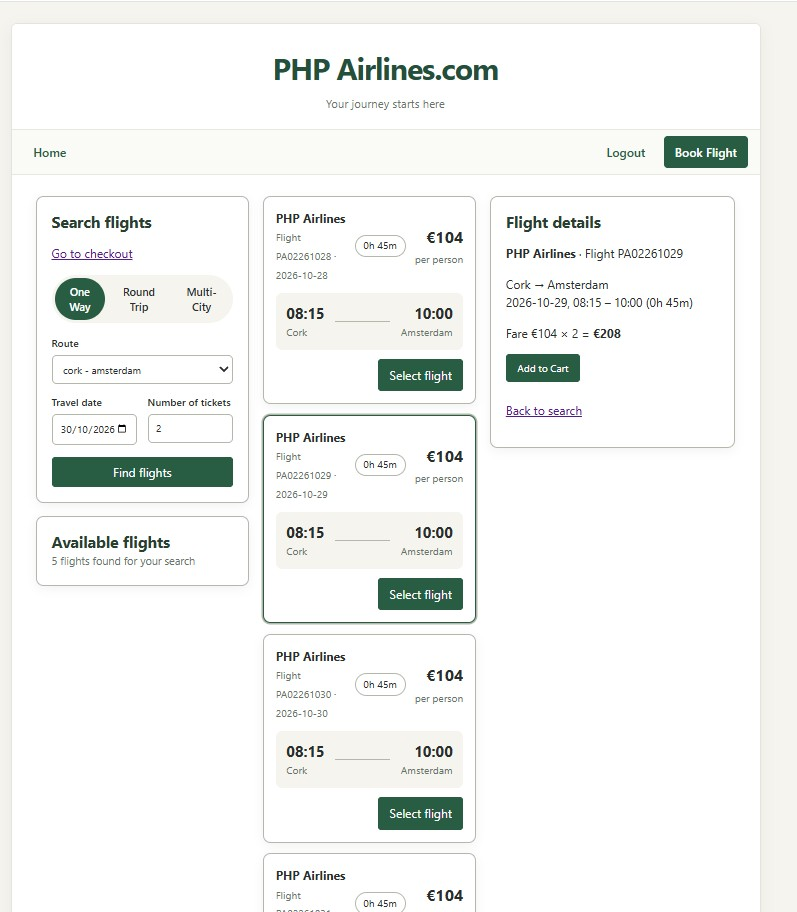

# Airline2026

Airline2026 is an original 2014 PHP airline booking application being restored and documented for local use. It provides customer booking and administrator route-management workflows backed by a MySQL database.

The goal of this repository is to preserve the original PHP architecture and interface, not to rewrite or redesign the application. The screenshots below document the application as it was implemented.

Originally developed as part of the **Higher Diploma in Cloud and Mobile with Data Science**, the project reflects the web development practices and conventions of its time.

| Screen | Description |
|---|---|
|  | Guest home screen with route, ticket, and date search |

## Technologies

The project uses the following technologies:

- PHP
- MySQL
- PDO for database access
- HTML forms and server-rendered views
- CSS (`mystyles.css` and `insidestyles.css`)
- PHP sessions and cookies for cart and login state

There is no standalone JavaScript source file in this repository; the application is primarily server-rendered PHP and HTML.

<!-- The supplied SQL dump was generated with PHP 5.4.19, MySQL 5.5.32, and phpMyAdmin 4.0.4.1 on 13 January 2014. Newer local PHP/MySQL versions may require compatibility changes that are outside the scope of this restoration. -->
The supplied SQL dump was generated with PHP 5.4.19, MySQL 5.5.32, and phpMyAdmin 4.0.4.1 on 25 October 2026. Newer local PHP/MySQL versions may require compatibility changes that are outside the scope of this restoration.


## Features

### Customer booking

- Search routes by origin, destination, travel date, and number of tickets
- Display matching flight results
- Check availability across the application's 20-seat flight model
- Select seats and add a provisional flight to the session-backed cart
- Review, update, or remove cart items
- Register a customer account or continue as a guest
- Enter passenger, passport, email, and payment details
- Complete a booking and write passenger and seat records to the database
- Log in and log out

### Administration

- Log in to the administration area
- View active routes
- Add routes with operating dates and prices
- Edit route prices
- Delete routes
- View a flight manifest
- Open flight details, including passenger and seat information
- View the route and passenger data used to calculate flight revenue

## Screenshots

The screenshots are existing captures of the original application. They document the customer booking flow and administrative screens without changing the application itself.

### Customer workflow

| Screen | Description |
|---|---|
|  | Guest home screen with route, ticket, and date search |
|  | Customer login form |
|  | Customer registration form |
|  | Search screen for a logged-in customer |
|  | Route search |
|  | Available flight results |
|  | Seat availability |
|  | Seat allocation after booking |
|  | Additional seat-allocation capture |
|  | Completed purchase screen |

### Administration workflow

| Screen | Description |
|---|---|
|  | Administrator route list and editing options |
|  | Add-route form |
|  | Additional add-route capture |
|  | Flight manifest and administration view |

## Running locally

The application is a traditional PHP application with `controller.php` as its entry point.

1. Install a local PHP runtime with the PDO MySQL extension and a MySQL server.
2. Create or import the `airline2013` database from [`airline2013.sql`](airline2013.sql).
3. Check the database host, port, username, password, and database name in `DBManager` in [`library.php`](library.php). Use local configuration appropriate for your machine rather than copying credentials from the historical source.
4. Serve the repository from a PHP-enabled web server.
5. Open `controller.php` in a browser.

For the current local development environment, the PHP development server can be started from PowerShell in the project directory:

```powershell
& "C:\php-8.4.26\php.exe" -S localhost:8000
```

The application can then be opened at:

[http://localhost:8000/controller.php](http://localhost:8000/controller.php)

The local MySQL instance uses host `127.0.0.1`, port `3307`, and database `airline2013`. The database username and password should remain specific to the local environment.

The SQL dump contains the original schema and sample data for the `login`, `user`, `routes`, and `passangers` tables. `passangers` is the historical spelling retained by the source and schema.

## Project structure

- [`controller.php`](controller.php) — central GET/POST command router and request handlers
- [`library.php`](library.php) — view classes, cart behaviour, seat processing, and `DBManager`
- [`airline2013.sql`](airline2013.sql) — MySQL schema and sample data
- [`mystyles.css`](mystyles.css) — customer-facing styles
- [`insidestyles.css`](insidestyles.css) — internal and administration styles
- [`assets/Images/`](assets/Images/) — existing application screenshots

The original interface uses a fixed-width layout of approximately 800 pixels and traditional CSS floats rather than a modern responsive framework. The source also contains historical naming and implementation patterns from the 2014 project.

The central controller dispatches requests to the relevant application logic and views. Supporting classes handle page presentation, cart operations, seat processing, and database access. This original structure is retained as part of the restoration.

## Naming Register

The original 2014 application was developed under time constraints, and some class, method, and controller command names reflect the naming conventions and experience of the time. As part of this restoration, we are documenting the existing names alongside clearer alternatives.

The principle is to preserve the working application and its original MVC structure. Classes and functions will be renamed incrementally, with their references checked and the affected workflows tested. This is a controlled improvement to the existing code, not a redesign.

The register distinguishes proposed names from changes that have been implemented and verified.

### 1. View classes

| Original name | Clearer name | Status |
|---|---|---|
| `OutsideView` | `PublicBaseView` | Proposed |
| `InsideView` | `AuthenticatedBaseView` | Proposed; confirm actual usage |
| `loginView` | `LoginView` | Proposed |
| `registerView` | `RegistrationView` | Proposed |
| `adminView` | `AdminRoutesView` | Proposed |
| `adminEditView` | `EditRouteView` | Proposed |
| `adminAddRoute` | `AddRouteView` | Proposed |
| `adminManifest` | `FlightManifestView` | Proposed |
| `SearchView` | `FlightSearchView` | Proposed |
| `ResultsView` | `FlightSearchResultsView` | Proposed |
| `purchaseView` | `PassengerDetailsView` | Proposed |
| `CheckoutView` | `CheckoutView` | Keep — already clear |
| `Cart` | `Cart` | Keep — already clear |
| `DBManager` | `DBManager` | Keep for now |

The proposed names describe each class's purpose more clearly. Class names will follow the PascalCase convention. Existing class names will remain in the register until any renaming has been implemented and tested.

### 2. Controller commands

Controller commands are values submitted through URLs, links, or HTML forms. The `main()` function in `controller.php` reads the `cmd` value and dispatches the request through a `switch` statement.

The following table records the original command values and proposed replacements. These are proposals, not completed changes.

| Original command | Proposed clearer command | Status |
|---|---|---|
| Empty command (`""`) | `showHome` or retain the default route | Review |
| `login` | `showLogin` | Proposed |
| `register` | `showRegistration` | Proposed |
| `loginRequest` | `authenticateUser` | Proposed |
| `registerRequest` | `registerUser` | Proposed |
| `search` | `searchFlights` | Proposed |
| `addToCart` | `addFlightToCart` | Proposed |
| `Update` | `updateCartSeats` | Proposed |
| `checkoutView` | `showCheckout` | Proposed |
| `customerRequest` | `submitPassengerDetails` | Proposed |
| `delCheckoutItem` | `removeCartItem` | Proposed |
| `purchase` | `showPassengerDetails` | Proposed |
| `editroute` | `showEditRoute` | Proposed |
| `amendroute` | `updateRoute` | Proposed |
| `deleteRoutes` | `deleteSelectedRoutes` | Proposed |
| `addRoutes` | `showAddRoute` | Proposed |
| `addRoute` | `createRoute` | Proposed |
| `manifest` | `showFlightManifest` | Proposed |
| `openflight` | `showFlightDetails` | Proposed |
| `defaultAdmin` | `showAdminDashboard` | Proposed |
| `viewdate` | `showFlightDate` | Review |
| `logout` | `logout` | Keep |

The empty command currently selects a default view based on the user's cookie. The `viewdate` command performs more than one action, so its replacement should be confirmed after its behaviour is understood.

### 3. Controller handler functions

A controller command and the PHP function that processes it are separate elements. Their names should be recorded separately where they differ.

The following table is based on the current `controller.php` source. The replacement names are proposals only.

| Original function | Proposed clearer name | Responsibility |
|---|---|---|
| `main()` | `dispatchRequest()` | Read the command and select the appropriate action |
| `validateDate()` | `isValidDate()` | Validate a date against a specified format |
| `handleSearch()` | `handleFlightSearch()` | Validate search inputs and display flight results |
| `handleAddToCart()` | `handleAddFlightToCart()` | Check seat availability and add a provisional flight to the cart |
| `handleAdduser()` | `handleUserRegistration()` | Register a user through `DBManager` |
| `handleUpdateprice()` | `handleRoutePriceUpdate()` | Update a route's price |
| `handleDeleteroutes()` | `handleRouteDeletion()` | Delete selected routes |
| `handleAddNewRoute()` | `handleRouteCreation()` | Validate operating dates and add a route |
| `handleAddtransation()` | `handlePassengerDetailsSubmission()` | Save submitted customer details to the cart's transaction data |
| `handleViewManifest()` | `handleFlightManifestRequest()` | Display the administrator's flight manifest |
| `handleLogin()` | `handleUserAuthentication()` | Authenticate the user and display the appropriate view |
| `handleSeating()` | `handleSeatOccupancyRequest()` | Request seat occupancy information |
| `handleprocessCart()` | `handleCartProcessing()` | Request cart processing through `DBManager` |
| `handledisplayFlightdetails()` | `handleFlightDetailsRequest()` | Retrieve flight and passenger details |

These names should be checked against the functions' full implementations and callers before adoption. In particular, `validateDate()` appears in the supplied controller but is not called there, and `handleprocessCart()` calls `DBManager::processCart()`, whose existence still needs to be confirmed.

### 4. `DBManager` methods

| Original method | Proposed clearer name | Status |
|---|---|---|
| `processLogin()` | `authenticateUser()` | Proposed |
| `addUser()` | `registerUser()` | Proposed |
| `updateRoute()` | `updateRoutePrice()` | Proposed |
| `checkSeats()` | `hasAvailableSeats()` | Proposed; confirm actual behaviour |
| `getAllRoutes()` | `getAllRoutes()` | Keep |
| `getRoute()` | `getRouteById()` | Proposed |
| `loadRoutes()` | `insertSampleRoutes()` | Proposed; confirm purpose |
| `displayRoutes()` | `displayRouteManagementList()` | Proposed |
| `displayStaticRoutes()` | `displayRouteDetails()` | Proposed |
| `displayActiveRoutes()` | `displayBookedFlights()` | Proposed; confirm purpose |
| `displayEditRoutes()` | `displayRouteForEditing()` | Proposed |
| `deleteRoutes()` | `deleteSelectedRoutes()` | Proposed |
| `addRoute()` | `createRoute()` | Proposed |
| `checkNmrroutes()` | `countRoutes()` | Proposed |
| `handleretrieveCustomerdetails()` | `displaySavedCustomerDetails()` | Proposed |
| `processTransaction()` | `recordPassengerBooking()` | Proposed; confirm transaction behaviour |
| `processSeating()` | `displaySeatOccupancy()` | Proposed |
| `processSeating1()` | `calculateAvailableSeats()` | Proposed |
| `processdisplayFlightdetails()` | `displayFlightManifestDetails()` | Proposed |

Some proposed names are deliberately descriptive and may be shortened after their responsibilities and call sites have been checked. The name should reflect what the method actually does, rather than what we assume it does from its original name.

### 5. `Cart` methods

| Original method | Proposed clearer name | Status |
|---|---|---|
| `addToCart()` | `addFlight()` | Proposed |
| `deleteFromCart()` | `removeFlight()` | Proposed |
| `updateTransactions()` | `recordBookings()` | Proposed; confirm its exact responsibility |
| `displayCart()` | `displayCart()` | Keep |
| `processFromCart()` | `processSeatSelections()` | Proposed |

### 6. Naming conventions

The following conventions will guide future changes:

- **Classes:** PascalCase, for example `FlightSearchView` and `RegistrationView`.
- **Methods and functions:** camelCase, for example `getRouteById()` and `recordPassengerBooking()`.
- **Controller commands:** descriptive camelCase values, for example `searchFlights` and `showCheckout`.
- **Database methods:** names that describe the operation and the object being acted on.
- **Legacy names:** retain the original names in this register until the corresponding changes have been implemented and tested.

Names belonging to different application layers should remain distinguishable. For example, the controller command `loginRequest`, the controller handler `handleLogin()`, and `DBManager::processLogin()` are related but separate elements of the application. Their replacements should reflect their respective responsibilities.

### 7. Renaming process

Changes will be made in small, related groups:

1. Finish documenting the existing classes, methods, controller commands, and handlers.
2. Check each proposed name against the actual implementation and its callers.
3. Confirm that the replacement accurately describes the code's behaviour.
4. Rename one related group at a time.
5. Search for references to the original names and update the relevant links, forms, dispatch conditions, and method calls.
6. Test the affected workflow.
7. Mark a change as implemented or tested only after verifying it.

The register provides a record of the original application's design and a controlled path towards clearer naming while preserving its existing functionality and MVC structure.

## Legacy status

This is a historical and educational application, not a production-ready booking system.

Before any real-world use, it would require a security and reliability review, including replacing plain-text credential handling, parameterising database queries, protecting sensitive customer and payment data, and updating legacy PHP/database conventions.

The immediate objective is to preserve the original application, document its functionality, and establish a working local reference. Any future modernisation should be treated as a deliberate subsequent stage rather than a replacement for the original project.