# Airline2026

Airline2026 is a student project that restores and extends an original 2014 airline booking application. It keeps a traditional server-rendered, database-driven PHP MVC structure while exploring the customer booking flow, Cart handling, aircraft-specific seat selection, and administrator route and manifest management features.

This repository was developed as a learning project for the **Higher Diploma in Cloud and Mobile with Data Science**. It is a local restoration and development exercise rather than a production-ready system. The interface and naming retain many conventions from the original 2014 application, and the project is intended to demonstrate PHP, SQL, and web application concepts in a classroom or portfolio context.

## Project status

- This is a student project and learning exercise.
- It is not intended for production deployment or real-world booking operations.
- The codebase demonstrates legacy web application patterns and is best treated as an educational reference.

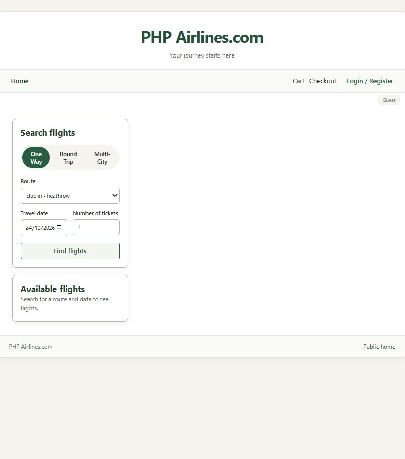
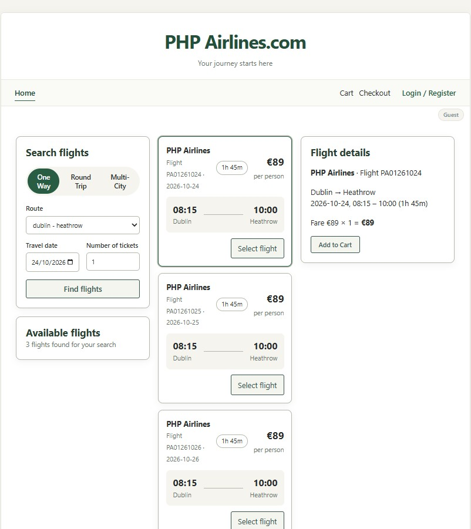
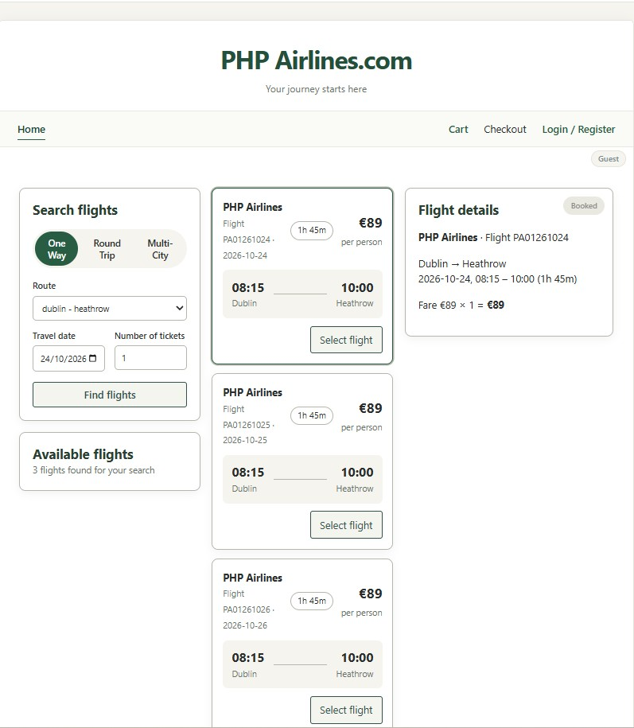

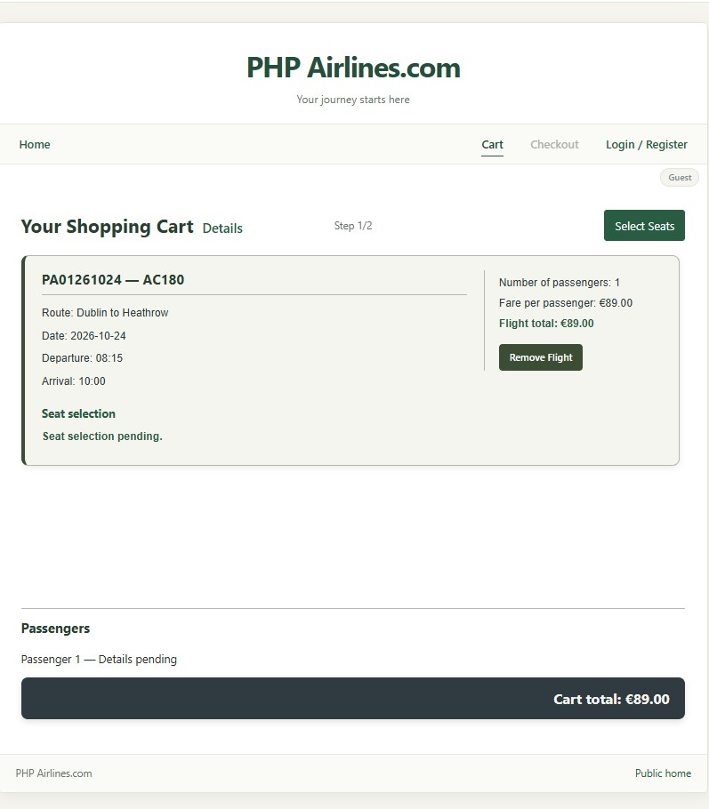
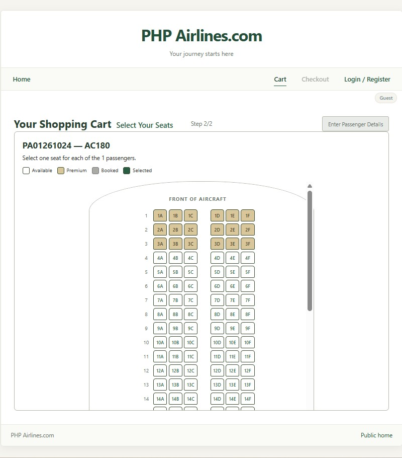
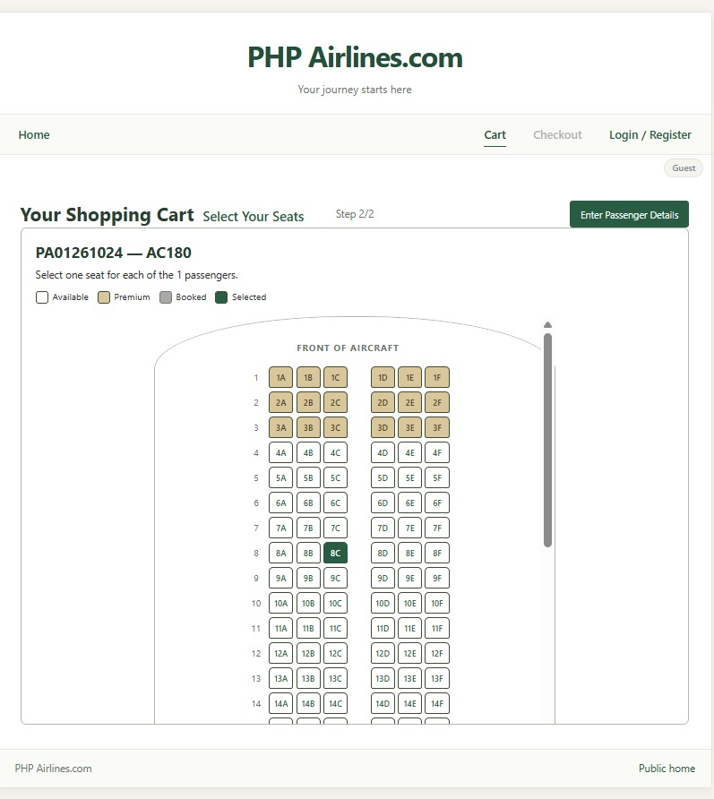


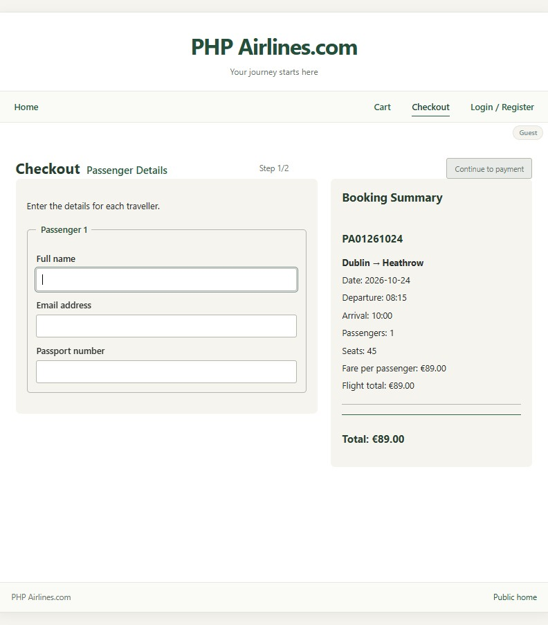

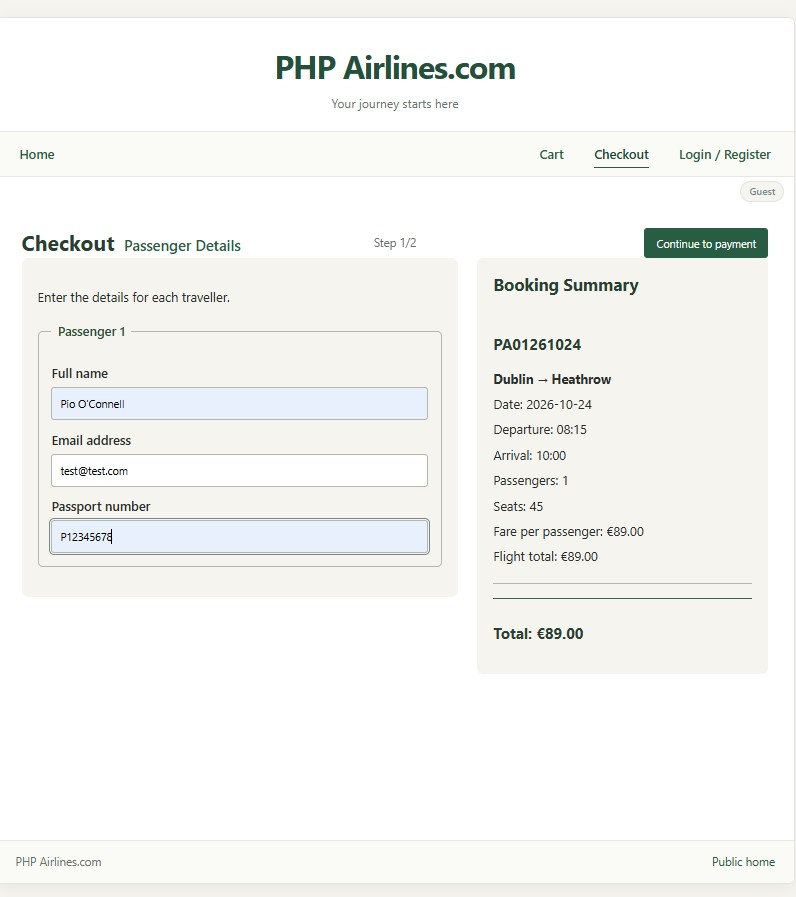
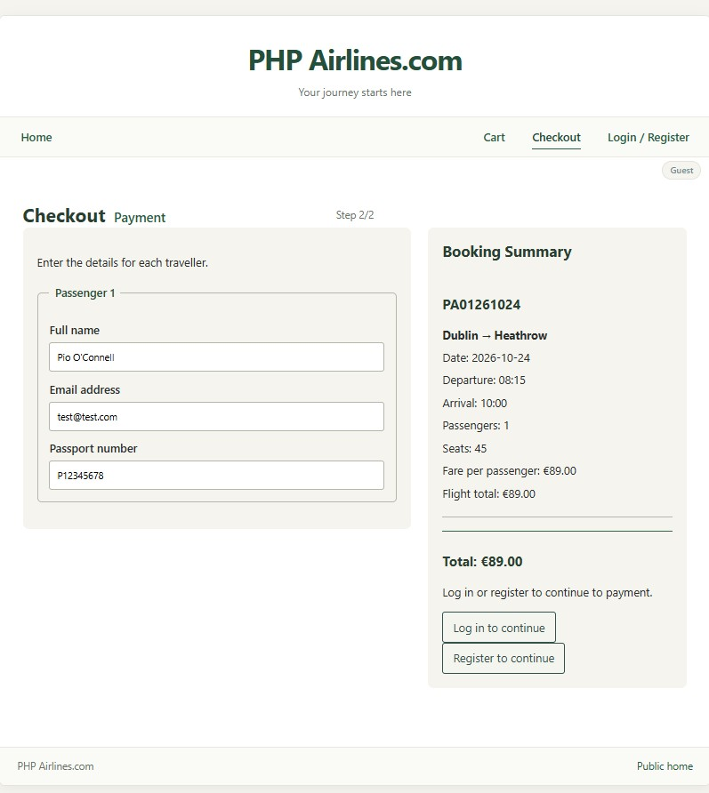

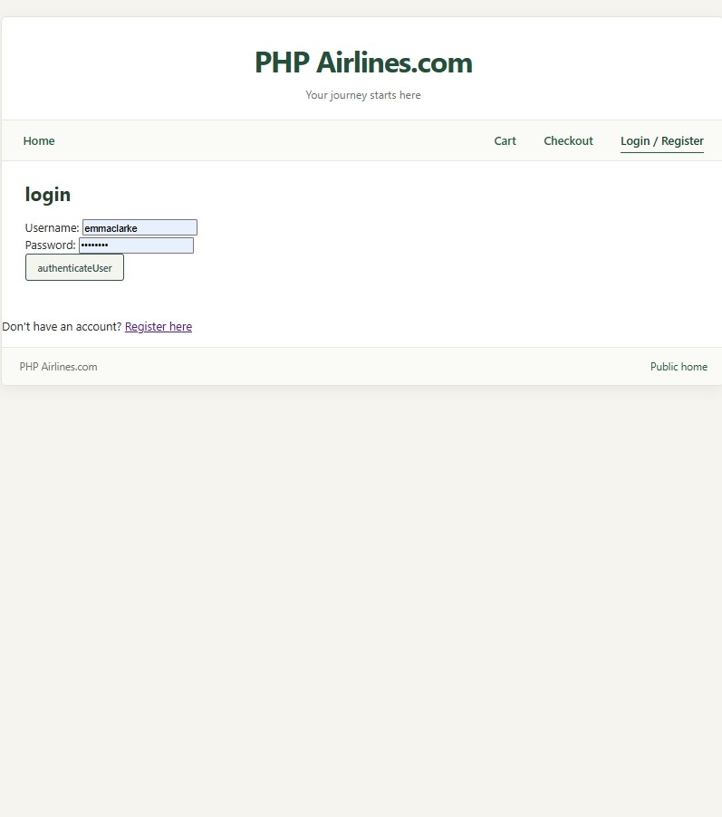
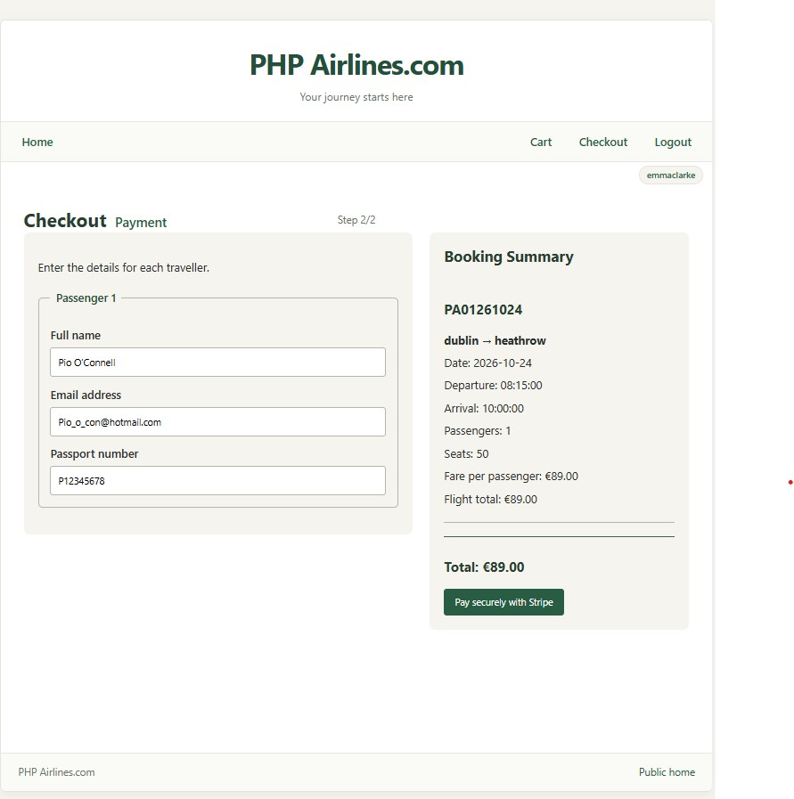

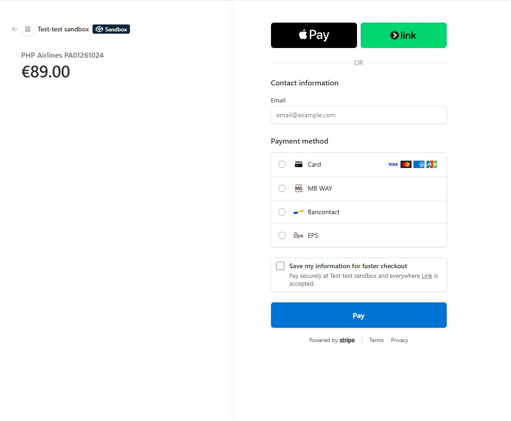
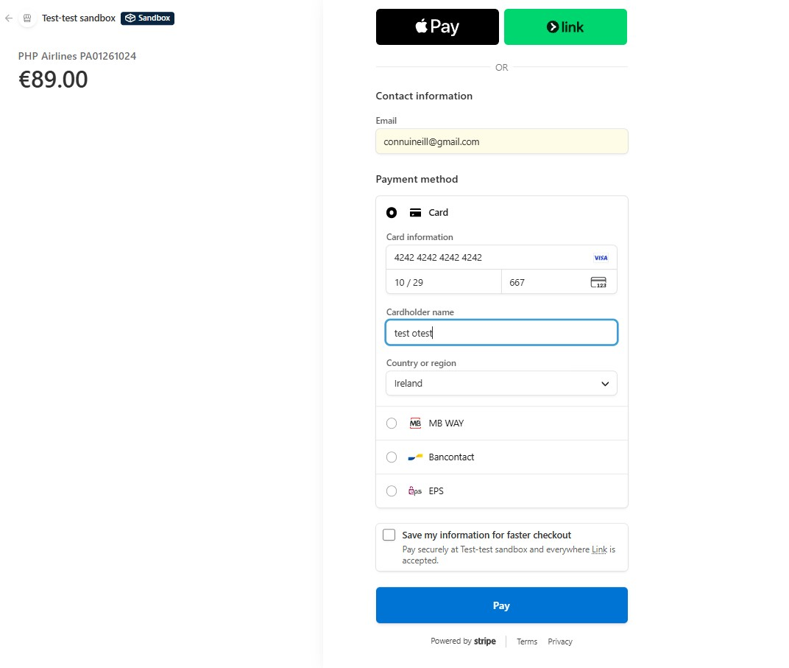
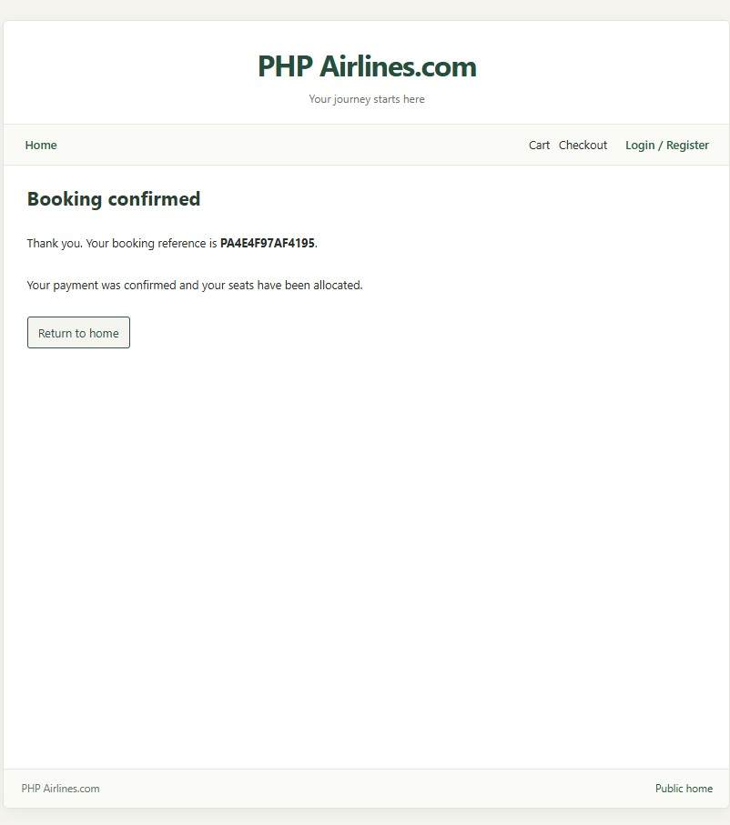


## Technology

- PHP 8.4.26 with PDO.
- MySQL 5.7 for the current local database.
- Server-rendered HTML forms and PHP views.
- Vanilla JavaScript for trip-type tabs and seat-selection interactions.
- CSS in `mystyles.css` and `insidestyles.css`.
- PHP sessions for login, Cart contents and booking-workflow state.
- SVG aircraft seating-plan reference artwork.
- Database-driven HTML seat controls styled with CSS.

The original SQL dump was produced in the PHP 5.4.19, MySQL 5.5.32 and phpMyAdmin 4.0.4.1 era. The current standalone database script targets MySQL 5.7.

The application remains primarily server-rendered. It does not use Bootstrap, a separate JavaScript application or a frontend framework.

## Functionality

### Customer and guest flight search

The guest and customer home pages share a three-pane flight workspace:

1. **Search Flights** — trip type, route, travel date and passenger/ticket count.
2. **Available Flights** — matching flight options.
3. **Selected Flight Details** — details of the selected flight and the Add to Cart action.

Current search-interface features include:

- One Way search.
- Round Trip and Multi-City tabs, currently presented as Coming Soon placeholders.
- Route selection.
- Travel-date selection.
- Passenger-count selection.
- Flight results and flight selection.
- Selected-flight details and fare calculation.
- Add to Cart action.

The current search uses the dated flight information available in the database. Round Trip and Multi-City are not yet implemented as complete booking journeys.

`GuestCheckoutView` and `CustomerCheckoutView` remain separate view classes but use the shared `CheckoutWorkspace` renderer for equivalent passenger forms, flight/seat summaries, totals, progress indicators and navigation. Guest checkout shows authentication actions before payment; authenticated customer checkout shows the payment action directly when the Cart is valid.

### Cart

The legacy Cart has been replaced with a session-based `Cart` class.

Current functionality includes:

- Add selected flights to the Cart.
- Use one shared cart workspace for guest and authenticated customer pages.
- Support multiple flight selections.
- Display flight details, passenger quantities and fares.
- Calculate and display the Cart total.
- Remove individual flights.
- Retain Cart state in the PHP session.
- Allow guests to build a Cart without logging in.
- Retain flight and aircraft information needed for seat selection.
- Store seat selections independently for each flight.

Each Cart flight is keyed by its own `flight_id`. Its Cart entry contains its own `seatSelections` array.

Passenger details are stored once at booking level rather than being duplicated for every flight leg. This allows the same passengers to travel on multiple selected flights.

All flight legs in a Cart must use the same passenger count. The current `Cart::addFlight()` method also limits the passenger count to 20.

A flight added to the Cart is not a confirmed booking. The Cart represents temporary session state.

The navigation reflects the booking state:

- Cart is disabled while the Cart is empty.
- Cart becomes available after a flight is added.
- Checkout remains disabled until the required seats have been selected and saved.
- The controller performs the authoritative seat validation when passenger details are requested.

Both guest and customer cart pages display **Your Shopping Cart**, **Details**, and **Step 1/2**. The Select Seats action uses the same primary green styling as Enter Passenger Details. Cart route and time values are formatted for display, such as `Dublin to Heathrow` and `08:15`, without changing the stored flight identifiers or fare values.

### Aircraft-specific seat selection

The application includes separate guest and authenticated customer seat-selection views:

- `GuestSeatSelectionView`
- `CustomerSeatSelectionView`

Both views use the shared `SeatSelectionWorkspace` trait and `SeatMapRenderer` class.

The seat-selection workflow:

- Loops through every flight in the Cart.
- Retrieves the seat map for each flight using its own `flight_id`.
- Uses the aircraft assigned to that flight to retrieve the seat definitions.
- Displays available, premium, booked and selected seat states.
- Retains selected seats independently for each Cart flight.
- Limits the number of selections to the passenger count for that flight.
- Validates submitted selections on the server before proceeding.

The seat map is generated using HTML controls and CSS rather than image hotspots. JavaScript provides immediate selection feedback and prevents the user from selecting more seats than the passenger count.

PHP and the database remain responsible for the authoritative seat data and validation.

The aircraft seating-plan imagery provides a visual reference for the aircraft presentation. Individual interactive seats are separate HTML elements.

The database defines two aircraft configurations:

| Aircraft | Capacity | Database configuration | Premium seats |
|---|---:|---|---:|
| `AC180` | 180 | 30 rows of 6 | 18 |
| `AC220` | 220 | 37 rows: 36 rows of 6 plus 4 seats | 18 |

The database is the source of truth for seat labels, row positions and premium classification.

**Important implementation note:** the current SQL defines both aircraft using seat positions A–F. The current `SeatMapRenderer`, however, declares AC220 using A–J in a 3–4–3 grouping. This discrepancy must be resolved so that the rendered AC220 arrangement agrees with the database before the layout is considered final.

### Passenger details and checkout

The application retains separate guest and customer booking paths.

Guests can search, add flights to the Cart and select seats without first registering or logging in.

Passenger information is stored once in the Cart's booking-level passenger collection. The current passenger-details view collects:

- Full name.
- Email address.
- Passport information.

The guest's Cart and booking information must be preserved through login or registration.

Authentication is intended to be required at checkout only. Guests should not be forced to log in before searching, adding flights or selecting seats.

Passenger-details and checkout views are part of the existing PHP view structure. The complete single-hop booking workflow has now been successfully tested in Stripe test mode, from passenger details through payment verification, booking persistence and confirmation.

### Stripe payment integration

The completed Stripe payment integration provides:

- Stripe Checkout Session creation using the Stripe HTTP API.
- Redirect to Stripe-hosted Checkout.
- Successful test payment processing.
- Retrieval of the Checkout Session from Stripe.
- Verification that `payment_status = paid` and `status = complete`.
- An idempotency check using the Stripe payment session ID.
- Transactional persistence of the booking, associated flights and passenger seat allocations.
- Generation of a unique booking reference.
- Display of the booking confirmation page.
- Retention of Cart state if booking confirmation fails.

A complete test booking was successfully completed on **10 November 2026**, confirming that Stripe payment verification, MySQL booking persistence, seat allocation and booking confirmation work together. This test used Stripe test mode and did not use live payment processing.

### Aircraft Seating Plans

The seat-selection interface supports the two aircraft configurations:

- **AC180** — 180 seats, with 18 premium seats.

  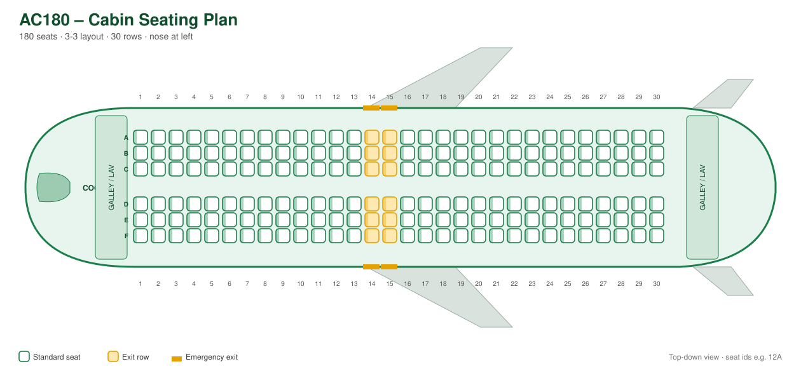

- **AC220** — 220 seats, with 18 premium seats.

  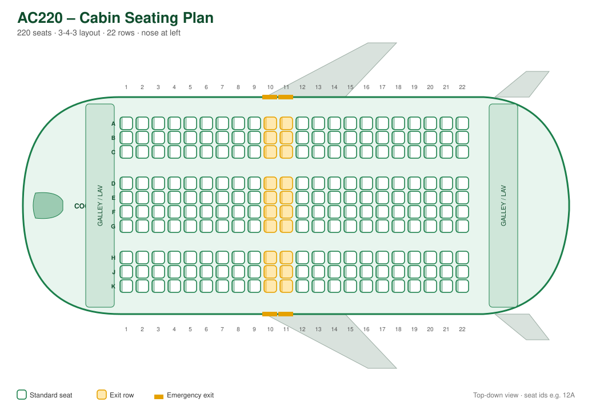

Each aircraft has its own seating-plan reference image.

The interactive seat map is rendered dynamically from the database rather than relying on static image hotspots.

Seat availability and occupancy are retrieved from the `aircraft_seats` table and the associated flight and passenger records. Passengers select seats using HTML controls styled with CSS.

The aircraft body and outline are created using CSS, allowing the aircraft presentation to be resized independently of the seat labels and interface text.

The SVG seating plans are reference artwork. They do not themselves provide the interactive seat controls.

### Administrator workflow

The existing PHP application provides administrator workflows to:

- Log in to the administration area.
- View active routes.
- Add routes with operating dates and prices.
- Edit route prices.
- Delete routes.
- View the flight manifest.
- Open flight details, including passenger and seat information.
- View route and passenger data used to calculate flight revenue.

The original administrator username `rmiller` is retained. The application identifies the administrator through the username. The database also retains the historical `login` table for compatibility.

## Intended booking workflow

The intended guest and customer journey is:

**Search Flights → Select Flight(s) → Add to Cart → Review Cart → Seat Selection → Passenger Details → Checkout → Payment → Payment Verification → Create Booking → Confirmation.**

The guest can progress through flight search, Cart handling, seat selection and passenger details without authentication.

Guests must log in or register before payment. The temporary guest Cart and booking details are transferred to the authenticated session unless that account already has saved booking state, in which case the account state takes precedence. Customer booking state is saved by account when logging out and restored on the next login.

The remaining work includes Stripe webhook handling, a richer booking confirmation itinerary, passenger confirmation emails, further payment and booking error logging and observability, and production configuration and security review before any live payments.

## Colour scheme

There are already many colours in a garden, so the application uses a restrained palette: a primary colour for text and headings, a secondary colour for calls to action (CTAs), and whitespace where appropriate.

The main page uses the **rule of thirds** to create a balanced and visually interesting composition.

[Image Color Picker](https://imagecolorpicker.com/) was used to help select the colour palette.

The original image is:

<details>
<summary>Click to view the original image</summary>

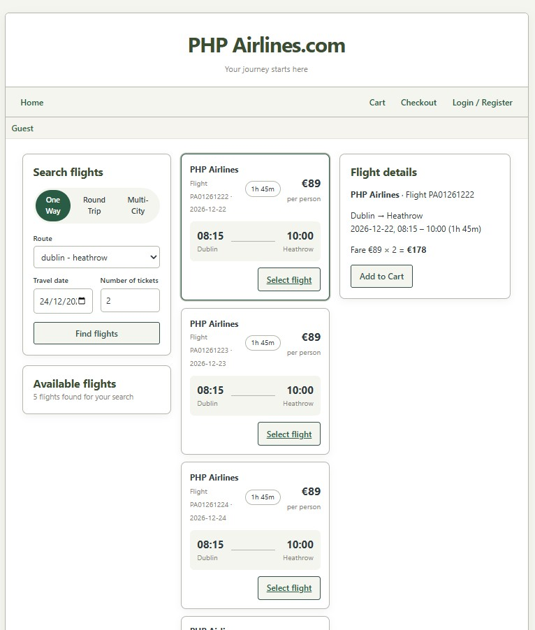

</details>

The resulting colour palette is shown below.

<div style="margin-left: 40px;">
  
</div>

<details>
<summary>Colour palette details</summary>

| Colour | Hex | Usage |
|---|---|---|
| Dark Forest Green | `#3B4D32` | Primary green / headings |
| Deep Green | `#2A5B44` | CTA / secondary colour |
| Off-White | `#F5F5F0` | Main background |
| Charcoal Blue-Grey | `#303B41` | Primary text |
| Muted Grey | `#878679` | Secondary text / subtle details |
| Dark Olive | `#444235` | Dark accents |
| Sage Grey | `#B3B8AB` | Borders and background areas |
| Muted Blue-Grey | `#738B8F` | Highlight links and hover effects |
| Deep Teal Green | `#33524E` | Supporting accents |

</details>

CSS custom properties use descriptive names:

```css
:root {
    --forest-green: #3b4d32;
    --deep-green: #2a5b44;
    --off-white: #f5f5f0;
    --charcoal-blue-grey: #303b41;
    --muted-grey: #878679;
    --dark-olive: #444235;
    --sage-grey: #b3b8ab;
    --muted-blue-grey: #738b8f;
    --deep-teal-green: #33524e;
}
```

The palette above documents the original design reference. The current stylesheets also use adjusted shades for individual components and authenticated pages.

### Seat-map state colours

The documented seat-state design uses the following reference colours:

| Seat state | Colour | Hex | Meaning |
|---|---|---|---|
| Available | Green | `#386747` | Seat can be selected |
| Selected | Blue | `#2563EB` | Seat currently selected |
| Occupied / unavailable | Grey | `#B8B8B8` | Seat is already allocated |
| Premium | Yellow | `#F4C542` | Premium seat classification |
| Hover / keyboard focus | Dark green outline | `#294D35` | Highlights the seat under interaction |

Premium status and seat availability are separate properties. A premium seat can be available, selected or occupied.

The current stylesheet contains component-specific colours, including a tan premium-seat colour, grey booked-seat colour and deep-green selected-seat colour. The rendered appearance is controlled by the CSS rules, so the reference colour table should not be interpreted as a guarantee that every current component uses those exact hex values.

The seat map includes a legend to explain the displayed states.

### General interface palette

| Interface element | Design reference |
|---|---|
| Main background | Off-white |
| Primary headings | Dark forest green |
| Primary text | Charcoal blue-grey |
| CTA buttons | Deep green |
| Borders and separators | Sage grey |
| Secondary text | Muted grey |
| Supporting accents | Deep teal green |

## Typography

Airline2026 uses two sans-serif font families to provide a clear visual hierarchy.

- **Primary — Roboto:** body text, forms, flight results, passenger details, seat labels and booking information.
- **Secondary — Montserrat:** page headings, section titles and selected navigation headings.

Both fonts use sensible fallback fonts.

```css
:root {
    --font-primary: "Roboto", "Segoe UI", Arial, sans-serif;
    --font-secondary: "Montserrat", "Roboto", "Segoe UI", Arial, sans-serif;
}
```

The colour palette and typography are intended to create a clear, accessible and consistent interface without unnecessarily changing the original application's layout and structure.

## Screenshots

These existing captures document the original customer and administration workflows.

### Customer workflow

| Screen | Description |
|---|---|
|  | Guest home screen with route, ticket and date search |
|  | Customer login form |
|  | Customer registration form |
|  | Search screen for a logged-in customer |
|  | Route search |
|  | Available flight results |
|  | Legacy seat availability |
|  | Historical seat allocation after booking |
|  | Additional seat-allocation capture |
|  | Historical completed purchase screen |

### Administration workflow

| Screen | Description |
|---|---|
|  | Administrator route list and editing options |
|  | Add-route form |
|  | Additional add-route capture (legacy filename) |
|  | Flight manifest and administration view (legacy filename) |

## Database installation

[`airline2026.sql`](airline2026.sql) is the **single, self-contained database installation script**.

It creates the `airline2026` database from scratch, creates its tables, relationships, indexes, trigger and constraints, and inserts the initial fictional test data.

The script is destructive: it drops and recreates the existing `airline2026` database. Any existing data in that database will be lost.

It does not need the historical backup to run. The separate `airline2013` database is not the target of this setup.

### Running the script locally

From the project root, use the following command in the VS Code PowerShell terminal:

```powershell
Get-Content ".\airline2026.sql" | & "C:\Program Files\MySQL\MySQL Server 5.7\bin\mysql.exe" -u root -p -h 127.0.0.1 -P 3307
```

Enter the MySQL root password when prompted.

This PowerShell command streams the local SQL file to the MySQL client. The script itself is responsible for creating the database, tables, constraints and initial data.

### Flight-code generation and duplicate prevention

The flight seed data generates flight codes using route identity and flight date.

This addresses the earlier duplicate-entry error involving `PA101` on `2026-10-24`, which violated the unique `uq_flights_code_date` constraint.

The corrected seed query uses `SELECT DISTINCT` to eliminate duplicate rows from its selected results. The unique constraint on flight code and flight date remains in place as a database-level safeguard.

### Verified local import results

The corrected script completed successfully in the local MySQL 5.7 environment. Its verification output reported the following table counts:

| Table | Reported rows |
|---|---:|
| `aircraft` | 2 |
| `aircraft_seats` | 400 |
| `booking` | 3 |
| `booking_flights` | 3 |
| `flights` | 2,788 |
| `login` | 3 |
| `passangers` | 6 |
| `routes` | 12 |
| `user` | 14 |

These are the counts reported by the local import verification query.

The aircraft verification output reported:

| Aircraft code | Capacity | Seat total | Premium seats |
|---|---:|---:|---:|
| `AC180` | 180 | 180 | 18 |
| `AC220` | 220 | 220 | 18 |

The SQL script also emits verification output for table counts, aircraft seat totals and duplicate passenger-seat groups.

### Verifying the database

After a successful import, connect to MySQL and run:

```sql
USE airline2026;
SHOW TABLES;

SELECT flight_code, flight_date, COUNT(*) AS duplicates
FROM flights
GROUP BY flight_code, flight_date
HAVING COUNT(*) > 1;
```

The final query should return an empty result set if no duplicate flight-code/date combinations exist.

To verify aircraft seat totals:

```sql
SELECT
    aircraft_code,
    capacity,
    COUNT(aircraft_seats.aircraft_id) AS seat_total,
    SUM(is_premium) AS premium_total
FROM aircraft
LEFT JOIN aircraft_seats USING (aircraft_id)
GROUP BY aircraft_id, aircraft_code, capacity;
```

The expected configurations are 180 seats for `AC180` and 220 seats for `AC220`, with 18 premium seats per aircraft.

## Tables and relationships

| Table | Purpose and important columns |
|---|---|
| `login` | Historical login-compatible username/password rows |
| `user` | Customer accounts: `id`, `username`, `password`, `email`, `CreditCardNo`, `passport`, `suspend` |
| `routes` | Route definitions: `id`, `source`, `dest`, `start`, `end`, `price` |
| `aircraft` | Aircraft configurations: `aircraft_id`, `aircraft_code`, `model`, `configuration_name`, `capacity` |
| `aircraft_seats` | Individual seats: `aircraft_id`, `seat_no`, `seat_label`, `seat_row`, `seat_position`, `is_premium` |
| `flights` | Dated departures: `flight_id`, `route_id`, `flight_date`, `flight_code`, `aircraft_id`, scheduled and expected times, `capacity`, `price`, `status` |
| `booking` | Booking header and optional customer/payment link: `booking_id`, `booking_reference`, `user_id`, `booking_status`, `payment_session_id`, `created_at` |
| `booking_flights` | Ordered booking-to-flight links: `booking_flight_id`, `booking_id`, `flight_id`, `sequence_no` |
| `passangers` | Legacy-spelled passenger records: `id`, `name`, `passport`, `route`, `date`, `registered`, `registeredName`, `creditCardno`, `email`, `seatNo`, `flight_id`, `booking_flight_id` |

Routes own flights. Flights reference routes and aircraft. Aircraft own their seat definitions. Bookings reference users where applicable and link to flights through `booking_flights`. Passenger records can reference routes, flights and optional booking-flight rows.

The unique `passangers(flight_id, seatNo)` key prevents the same seat from being recorded twice on a flight.

A trigger fills `flight_id` for compatible legacy PHP inserts that provide only route and date information.

The database includes fictional 180-seat `AC180` and 220-seat `AC220` configurations. Individual seats have visual labels such as `1A`; seats 1 through 18 are marked premium.

The `passangers` spelling is retained for compatibility with the original application.

## Run locally

The traditional PHP entry point is `controller.php`.

1. Install PHP with the PDO MySQL extension and a local MySQL 5.7 server.
2. Run [`airline2026.sql`](airline2026.sql) using the installation command above.
3. From the project root, start the PHP development server:

   ```powershell
   & "C:\php-8.4.26\php.exe" -S localhost:8000
   ```

4. Open [http://localhost:8000/controller.php](http://localhost:8000/controller.php).
5. Test guest flight search, registration/login, Cart handling, seat selection and administrator route/manifest pages.

Use the fictional accounts in the SQL data for testing. The suspended sample user is `eoinnolan`; the current PHP authentication method does not enforce the `suspend` flag, so suspension is stored data rather than a complete application feature.

The local PHP configuration in `library.php` uses host `127.0.0.1`, port `3307`, database `airline2026`, user `root`, and the configured local password. Check the local configuration on your own machine. Development credentials must not be used in production.

## Project structure

- `controller.php` — central GET/POST command router and request handlers.
- `library.php` — view classes, Cart behaviour, seat processing and `DBManager`.
- `airline2026.sql` — standalone MySQL 5.7 database schema and test data.
- `mystyles.css` — public and guest-facing styles.
- `insidestyles.css` — authenticated customer and administration styles.
- `assets/Images/` — application imagery and screenshots.
- `assets/Images/planes/Claude/` — AC180 and AC220 SVG seating-plan artwork.
- `assets/Images/seating-plans/` — additional illustrative aircraft seating-plan images.
- `old/airline2026_backup.sql` — historical backup/reference only.

The page frame is responsive up to approximately 1000 pixels wide. The application retains traditional PHP rendering and its original MVC organisation rather than adopting a modern frontend framework.

`controller.php` dispatches requests to the views and handlers in `library.php`. Supporting classes handle page presentation, Cart operations, seat processing and database access.

## View class hierarchy

Public and private views are separate hierarchies with their own base class and stylesheet.

```text
PublicBaseView (abstract)
├── PublicHomeView
├── LoginView
├── RegistrationView
└── GuestSeatSelectionView

PrivateBaseView (abstract, standalone)
├── CustomerBaseView (abstract)
│   ├── CustomerHomeView
│   │   └── CustomerFlightResultsView
│   ├── CustomerSeatSelectionView
│   ├── CustomerCheckoutView
│   └── CustomerCartView
└── AdminBaseView (abstract)
    ├── AdminRoutesView
    │   └── AdminView
    ├── AdminEditRouteView
    ├── AdminAddRouteView
    └── AdminFlightManifestView
```

`GuestSeatSelectionView` extends `PublicBaseView`.

`CustomerSeatSelectionView`, `CustomerCheckoutView` and `CustomerCartView` belong to the customer hierarchy.

`AdminView` is a thin subclass of `AdminRoutesView`.

`Cart` and `DBManager` are standalone classes.

### Shared flight workspace

The guest and customer home pages use the `FlightWorkspace` trait to share the three-pane flight-search interface without duplicating its markup.

The panes are:

1. **Search Flights** — trip-type tabs, route selector, travel date and passenger count.
2. **Available Flights** — matching flight options.
3. **Selected Flight Details** — selected flight information and Add to Cart action.

The public and private view hierarchies remain separate. The shared trait provides common flight-workspace behaviour.

### Shared seat-selection workspace

The guest and authenticated customer seat-selection views use the `SeatSelectionWorkspace` trait.

The trait:

- Reads the Cart from the PHP session.
- Loops through each selected flight.
- Retrieves that flight's seat map using its `flight_id`.
- Passes the seat map and selected seats to `SeatMapRenderer`.
- Renders the seat-selection form for all Cart flights.
- Uses JavaScript to enforce the passenger-count limit independently for each flight.

`SeatMapRenderer` creates the actual HTML seat controls and displays the seat labels, premium status, occupancy and selected state.

## Cart and booking data design

The `Cart` class is session-based and supports multiple flight selections.

Each flight is stored under its own `flight_id`. The flight entry includes the flight information, passenger count, fare information and its own `seatSelections` array.

Passenger details are stored once in the Cart's booking-level passenger collection. This avoids duplicating the same passenger records for each flight leg.

The current Cart responsibilities include:

- Add a flight.
- Remove a flight.
- Retrieve one flight.
- Retrieve all Cart flights.
- Retain passenger information.
- Update passenger details.
- Store selected seat numbers per flight.
- Calculate the grand total.
- Display the Cart.

The seat-selection methods validate the submitted number of seats, reject duplicate seat numbers and check that selected seats exist and are available for the corresponding flight.

After passenger details are saved, guests and authenticated customers can start a Stripe Checkout payment. The return handler retrieves the Checkout Session from Stripe and verifies both `status=complete` and `payment_status=paid` before creating the booking.

Booking persistence runs in a MySQL transaction. It revalidates every selected seat, inserts the booking, flight links and passenger allocations, and clears the Cart only after a successful commit. A unique Stripe session ID prevents a refreshed success URL from creating a second booking. If booking confirmation fails, the Cart is retained.

The `booking` table includes a nullable `payment_session_id VARCHAR(255)` column and the unique index `uq_booking_payment_session`. Together, these associate a Stripe Checkout Session with no more than one booking and support the idempotency check.

## Current implementation and remaining work

| Area | Current position |
|---|---|
| Public guest homepage | Implemented |
| Customer homepage | Implemented |
| Shared three-pane flight workspace | Implemented |
| One Way search | Implemented |
| Round Trip and Multi-City | Placeholder only |
| Session-backed Cart | Implemented |
| Multiple flights in Cart | Implemented |
| Guest Cart access | Implemented |
| Passenger information stored once per booking | Implemented in Cart |
| Guest seat-selection view | Implemented |
| Customer seat-selection view | Implemented |
| Shared seat-map renderer | Implemented |
| Flight-specific seat-map retrieval | Implemented |
| Premium and booked seat presentation | Implemented |
| Independent seat selections per flight | Implemented |
| Client-side passenger-count selection limit | Implemented |
| Server-side seat-selection validation | Implemented |
| Passenger-details view | Implemented for guests and customers |
| Shared cart workspace and progress presentation | Implemented for guests and customers |
| Cart and Checkout navigation state gating | Implemented |
| Cart route and time display formatting | Implemented |
| Guest passenger details before login | Implemented; the Cart and booking state are retained in the session |
| Stripe Checkout payment | Implemented through the Stripe HTTP API |
| Payment verification | Implemented on the server when Stripe redirects back |
| Transactional booking completion | Implemented using `booking`, `booking_flights` and `passangers` |
| Booking confirmation and reference | Implemented |

The aircraft configurations in the database are authoritative. The AC180 and AC220 rendered layouts must match their actual seat definitions, including the four-seat final row of AC220.

## Remaining booking enhancements

The next development stages are:

1. Add Stripe webhook handling for asynchronous payment and dispute events.
2. Generate a richer booking confirmation itinerary.
3. Send passenger confirmation emails.
4. Improve payment and booking error logging and observability.
5. Complete production configuration and security review before any live payments.

The browser's seat map is a presentation of current availability, not a reservation lock. Seat availability must be checked again when the booking is confirmed.

The completed booking operation:

- Revalidate each selected flight.
- Confirm that every selected seat belongs to the aircraft assigned to that flight.
- Confirm that no selected seat has already been allocated to another passenger.
- Confirm that the number of seats matches the passenger count.
- Insert the booking, flight links and passenger allocations in a database transaction.
- Roll back the transaction if any operation fails.
- Retain the Cart if confirmation fails.
- Clear the Cart only after successful confirmation.

The existing unique key on `passangers(flight_id, seatNo)` provides a database-level safeguard against duplicate seat allocations.

## Scope and compatibility

The enhancements preserve:

- The existing PHP server-rendered MVC approach.
- The `PublicBaseView`, `PrivateBaseView`, customer and administrator class hierarchy.
- Separate public and internal stylesheets.
- The existing MySQL tables and relationships.
- The legacy `passangers` table spelling for compatibility.
- The established Airline2026 colour palette and typography.
- The session-backed Cart design.
- Account-scoped draft booking state used to restore customer Carts after logout and login.

The seat-map work extends the existing application. It does not introduce a separate JavaScript framework or replace the original backend architecture.

## Backup and limitations

`old/airline2026_backup.sql` is a retained historical backup/reference dump. It is not required for installation and must not be run in sequence with the standalone script.

Known limitations include:

- Round Trip and Multi-City search are not implemented.
- AC220's current renderer grouping does not match the database's A–F seat configuration and must be aligned.
- Stripe Checkout requires the PHP cURL extension and a configured secret key.
- The current flow verifies payment on the Stripe success redirect; a webhook is still recommended for production-grade asynchronous payment handling.
- The application does not store raw card details. Stripe handles card collection on its hosted Checkout page.
- Passwords are stored and compared in plain text for legacy compatibility.
- Several PHP queries use string interpolation rather than prepared statements.
- The `suspend` field is stored but is not enforced by the current authentication method.
- Payment details are fictional test data; there is no production payment processing.
- The project is not a production-ready airline operations or booking system.

Before real-world use, the application would require a security and reliability review, secure credential handling, parameterized queries, protection of customer/payment data, and modernization of legacy PHP/database conventions.

### Stripe Checkout configuration

Set `STRIPE_SECRET_KEY` in the PHP process environment. Use a `sk_test_...` key for local development and use Stripe's test card `4242 4242 4242 4242` with any future expiry date and CVC.

For the local PHP server, PowerShell can set the key for the current terminal before starting PHP:

```powershell
$env:STRIPE_SECRET_KEY = "sk_test_your_key"
& "C:\php-8.4.26\php.exe" -S localhost:8000
```

The application creates EUR Checkout line items from the Cart, redirects the browser to Stripe, verifies the returned Checkout Session server-side, and then commits the booking. Never commit a Stripe key or place it in source control.

## Refactor history

In 2026 the view classes were renamed for clarity and the private view tree was made independent of the public one, while retaining the original server-rendered MVC approach.

| 2014 class name | Current class name |
|---|---|
| `AuthenticatedBaseView` | `PrivateBaseView` |
| `FlightSearchView` | `CustomerHomeView` |
| `FlightSearchResultsView` | `CustomerFlightResultsView` |
| `PassengerDetailsView` | `CustomerCheckoutView` |
| `CheckoutView` | `CustomerCartView` |
| `InnerAdminView` | `AdminView` |
| `EditRouteView` | `AdminEditRouteView` |
| `AddRouteView` | `AdminAddRouteView` |
| `FlightManifestView` | `AdminFlightManifestView` |
| `PublicBaseView` | `PublicBaseView` (unchanged) |
| `PublicHomeView` | `PublicHomeView` (unchanged) |
| `LoginView` | `LoginView` (unchanged) |
| `RegistrationView` | `RegistrationView` (unchanged) |
| `CustomerBaseView` | `CustomerBaseView` (unchanged) |
| `AdminBaseView` | `AdminBaseView` (unchanged) |
| `AdminRoutesView` | `AdminRoutesView` (unchanged) |
| `Cart` | `Cart` (unchanged) |
| `DBManager` | `DBManager` (unchanged) |

`AdminView` is a thin subclass of `AdminRoutesView`, retained from the original `InnerAdminView / AdminRoutesView` arrangement.

A shared `FlightWorkspace` trait was introduced to provide the three-pane search interface for both guest and customer views without duplicating markup.

The shared `SeatSelectionWorkspace` trait and `SeatMapRenderer` were introduced to provide the aircraft seat-selection interface to both guest and authenticated customers.