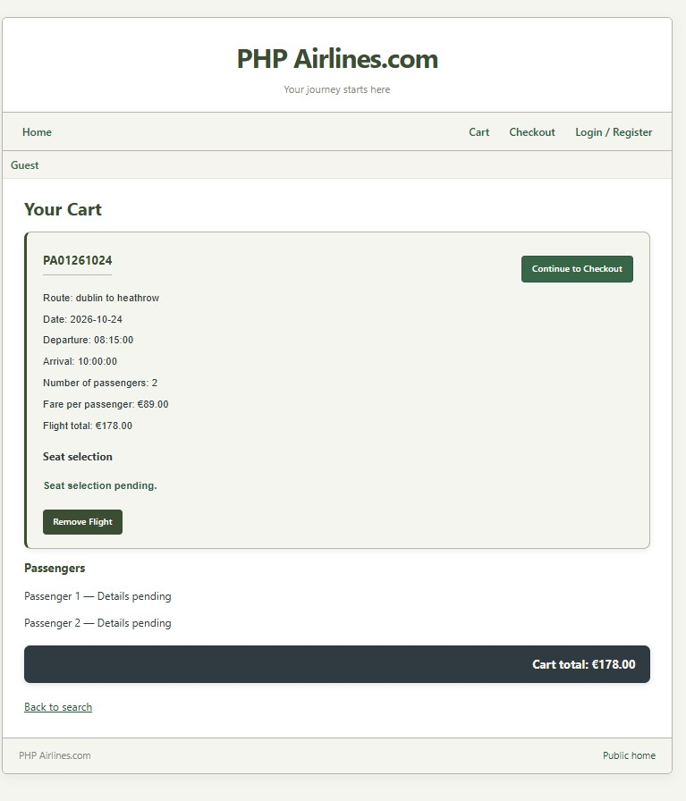
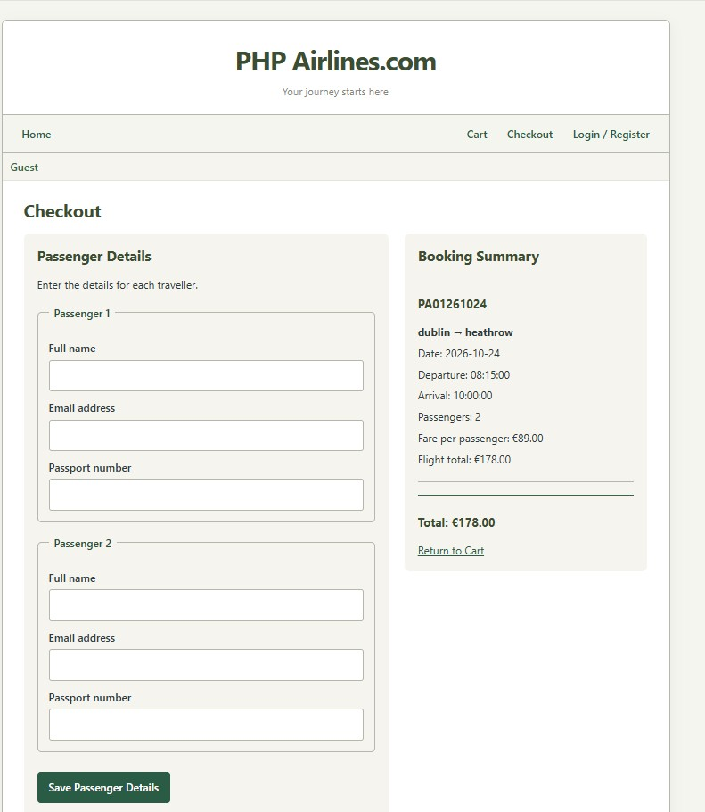
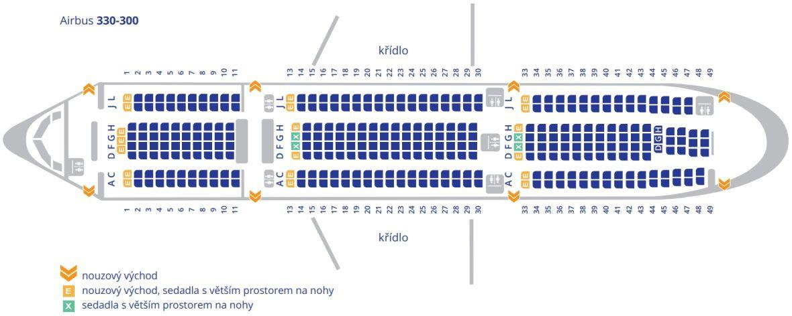
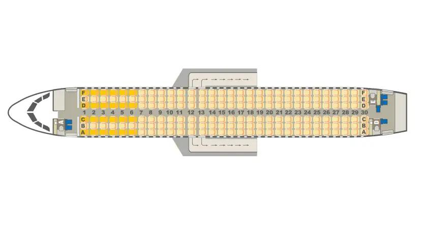

# Airline2026

Airline2026 restores and develops an original 2014 PHP airline booking application. It preserves the historical server-rendered MVC style while providing customer booking, passenger and seat handling, and administrator route and manifest workflows.

The original application was developed as part of the **Higher Diploma in Cloud and Mobile with Data Science**. This project is a local restoration and development reference, not a replacement rewrite. Its interface and naming retain many conventions from the 2014 application.





## Technology

- PHP with PDO
- MySQL 5.7 for the current local database
- Server-rendered HTML forms and PHP views
- Light vanilla JavaScript for the trip-type tabs and planned seat-selection interactions
- CSS in [`mystyles.css`](mystyles.css) and [`insidestyles.css`](insidestyles.css)
- PHP sessions and cookies for login and Cart state

The original SQL dump was produced in the PHP 5.4.19, MySQL 5.5.32, and phpMyAdmin 4.0.4.1 era. The current standalone database script targets MySQL 5.7. The application remains primarily server-rendered; there is no separate JavaScript application in this repository.

## Functionality

### Customer booking workflow

The current PHP source retains the original customer-facing workflow and interface:

- Three-pane flight workspace:
  1. **Search Flights** — trip type, route, travel date and passenger/ticket count.
  2. **Available Flights** — matching flight options.
  3. **Selected Flight Details** — details of the selected option and the **Add to Cart** action.
- Trip-type tabs: **One Way** (active), Round Trip and Multi-City (placeholders marked “Coming Soon”).
- Route search by origin, destination, travel date and number of tickets.
- Flight selection and session-backed Cart handling.
- Cart review, item removal and the existing legacy seat-selection interface.
- Customer registration, guest access, login and logout.
- Passenger name, passport, email and payment-detail forms.
- Legacy passenger and seat information written to the database.

The current PHP search and seat interfaces still contain legacy behaviour. In particular, the current search has not yet been fully migrated to use the dated `flights` table, and the active Cart interface displays 20 legacy seat positions. The full dated-flight and aircraft-specific seat-map workflow described later in this README is planned development, not a claim about the current implementation.

The intended booking workflow is:

**Search Flights → Select Flight(s) → Add to Cart → Review Cart → Seat Selection → Passenger Details → Checkout → Guest Login/Register if required → Payment → Payment Verification → Create Booking → Confirmation.**

Guests may search, add flights to the Cart, select seats and enter passenger details without logging in. Authentication is required at checkout only. The guest's Cart, passenger details and seat selections must survive login or registration.

### Administrator workflow

The existing PHP application provides administrator workflows to:

- Log in to the administration area.
- View active routes.
- Add routes with operating dates and prices.
- Edit route prices.
- Delete routes.
- View the flight manifest.
- Open flight details, including passenger and seat information.
- View route and passenger data used to calculate flight revenue.

The administrator account is `rmiller` / `rmiller`. The PHP controller authorizes this account by username. The database also retains the historical `login` table for compatibility.

## Colour scheme

There are already many colours in a garden, so the application uses a restrained palette: a primary colour for text and headings, a secondary colour for calls to action (CTAs), and whitespace where appropriate.

The main page uses the **rule of thirds** to create a balanced and visually interesting composition.

[Image Color Picker](https://imagecolorpicker.com/) was used to help select the colour palette.

The original image is:

<details>
<summary>Click to view the original image</summary>


</details>

The resulting colour palette is shown below.

<div style="margin-left: 40px;">
  
</div>

<details>
<summary>Colour palette details</summary>

| Colour | Hex | Usage |
|---|---|---|
| Dark Forest Green | `#3B4D32` | Primary green / headings |
| Deep Green | `#2A5B44` | CTA / secondary colour |
| Off-White | `#F5F5F0` | Main background |
| Charcoal Blue-Grey | `#303B41` | Primary text |
| Muted Grey | `#878679` | Secondary text / subtle details |
| Dark Olive | `#444235` | Dark accents |
| Sage Grey | `#B3B8AB` | Borders and background areas |
| Muted Blue-Grey | `#738B8F` | Highlight links and hover effects |
| Deep Teal Green | `#33524E` | Supporting accents |

</details>

CSS custom properties use descriptive names rather than hexadecimal values as variable names. The palette can be represented in CSS as follows:

```css
:root {
    --forest-green: #3b4d32;
    --deep-green: #2a5b44;
    --off-white: #f5f5f0;
    --charcoal-blue-grey: #303b41;
    --muted-grey: #878679;
    --dark-olive: #444235;
    --sage-grey: #b3b8ab;
    --muted-blue-grey: #738b8f;
    --deep-teal-green: #33524e;
}
```

### Seat-map state colours

The aircraft seat map will use a dedicated set of state colours that remains visually consistent with the wider Airline2026 palette:

| Seat state | Colour | Hex | Meaning |
|---|---|---|---|
| Available | Green | `#386747` | Seat can be selected |
| Selected | Blue | `#2563EB` | Seat currently selected by this customer |
| Occupied / unavailable | Grey | `#B8B8B8` | Seat is already allocated and cannot be selected |
| Premium | Yellow | `#F4C542` | Premium seat; premium status is independent of occupancy |
| Hover / keyboard focus | Dark green outline | `#294D35` | Highlights the seat currently under interaction |

Premium status and seat availability are separate properties. For example, an available premium seat is yellow; once selected it uses the selected blue state; if occupied it uses the unavailable grey state. A legend will explain the states beside the seat map.

The general page palette remains in use for the surrounding interface:

| Interface element | Colour |
|---|---|
| Main background | `#F5F5F0` |
| Primary headings | `#3B4D32` |
| Primary text | `#303B41` |
| CTA buttons | `#2A5B44` |
| Borders and separators | `#B3B8AB` |
| Secondary text | `#878679` |

## Typography

Airline2026 uses two sans-serif font families to provide a clear visual hierarchy and consistent presentation across public pages, passenger booking workflows and administrator views.

- **Primary — Roboto:** body text, forms, flight results, passenger details, seat labels and booking information. Its legibility makes it suitable for information-dense interfaces.
- **Secondary — Montserrat:** page headings, section titles and selected navigation headings. Its geometric style gives headings a distinctive appearance while complementing the primary font.

Both fonts use sensible fallback fonts to maintain readability if the preferred fonts are unavailable.

```css
:root {
    --font-primary: "Roboto", "Segoe UI", Arial, sans-serif;
    --font-secondary: "Montserrat", "Roboto", "Segoe UI", Arial, sans-serif;
}
```

The colour palette and typography are intended to work together to create a clear, accessible and consistent interface without unnecessarily changing the original application's layout and structure.

## Screenshots

These existing captures document the original customer and administration workflows.

### Customer workflow

| Screen | Description |
|---|---|
|  | Guest home screen with route, ticket and date search |
|  | Customer login form |
|  | Customer registration form |
|  | Search screen for a logged-in customer |
|  | Route search |
|  | Available flight results |
|  | Legacy seat availability |
|  | Seat allocation after booking |
|  | Additional seat-allocation capture |
|  | Completed purchase screen |

### Administration workflow

| Screen | Description |
|---|---|
|  | Administrator route list and editing options |
|  | Add-route form |
|  | Additional add-route capture (legacy filename) |
|  | Flight manifest and administration view (legacy filename) |

## Database installation

[`airline2026.sql`](airline2026.sql) is the **single, self-contained database installation script**.

It creates the `airline2026` database from scratch, creates its tables, relationships, indexes, trigger and constraints, and inserts the initial fictional test data. The database is not installed through an initial import followed by a separate update script.

The script is destructive: it drops and recreates the existing `airline2026` database. Any existing data in that database will be lost. It does not need the historical backup to run. The separate `airline2013` database is not the target of this setup.

### Running the script locally

From the project root, use the following command in the VS Code PowerShell terminal:

```powershell
Get-Content ".\airline2026.sql" | & "C:\Program Files\MySQL\MySQL Server 5.7\bin\mysql.exe" -u root -p -h 127.0.0.1 -P 3307
```

Enter the MySQL root password when prompted.

This PowerShell command streams the local SQL file to the MySQL client. The script itself is responsible for creating the database, tables, constraints and initial data.

### Flight-code generation and duplicate prevention

The flight seed data generates flight codes using route identity and flight date. This addresses the earlier duplicate-entry error involving `PA101` on `2026-10-24`, which violated the unique `uq_flights_code_date` constraint.

The corrected seed query also uses `SELECT DISTINCT` to eliminate duplicate rows from its selected results. The unique constraint on flight code and flight date remains in place as a database-level safeguard.

`SELECT DISTINCT` does not replace the unique constraint: the generated values must still satisfy the database's uniqueness rules.

### Verified local import results

The corrected script completed successfully in the local MySQL 5.7 environment. Its verification output reported the following table counts:

| Table | Reported rows |
|---|---:|
| `aircraft` | 2 |
| `aircraft_seats` | 400 |
| `booking` | 3 |
| `booking_flights` | 3 |
| `flights` | 2,788 |
| `login` | 3 |
| `passangers` | 6 |
| `routes` | 12 |
| `user` | 14 |

These are the counts reported by the local import verification query. MySQL table statistics can be approximate where InnoDB statistics are used.

The aircraft verification output reported:

| Aircraft code | Capacity | Seat total | Premium seats |
|---|---:|---:|---:|
| `AC180` | 180 | 180 | 18 |
| `AC220` | 220 | 220 | 18 |

The SQL script also emits verification output for table counts, aircraft seat totals and duplicate passenger-seat groups.

### Verifying the database

After a successful import, connect to MySQL and run:

```sql
USE airline2026;
SHOW TABLES;

SELECT flight_code, flight_date, COUNT(*) AS duplicates
FROM flights
GROUP BY flight_code, flight_date
HAVING COUNT(*) > 1;
```

The final query should return an empty result set if no duplicate flight-code/date combinations exist.

To verify aircraft seat totals:

```sql
SELECT
    aircraft_code,
    capacity,
    COUNT(aircraft_seats.aircraft_id) AS seat_total,
    SUM(is_premium) AS premium_total
FROM aircraft
LEFT JOIN aircraft_seats USING (aircraft_id)
GROUP BY aircraft_id, aircraft_code, capacity;
```

The expected configurations are 180 seats for `AC180` and 220 seats for `AC220`, with 18 premium seats per aircraft.

## Tables and relationships

| Table | Purpose and important columns |
|---|---|
| `login` | Historical login-compatible username/password rows |
| `user` | Customer accounts: `id`, `username`, `password`, `email`, `CreditCardNo`, `passport`, `suspend` |
| `routes` | Route definitions: `id`, `source`, `dest`, `start`, `end`, `price` |
| `aircraft` | Aircraft configurations: `aircraft_id`, `aircraft_code`, `model`, `configuration_name`, `capacity` |
| `aircraft_seats` | Individual seats: `aircraft_id`, `seat_no`, `seat_label`, `seat_row`, `seat_position`, `is_premium` |
| `flights` | Dated departures: `flight_id`, `route_id`, `flight_date`, `flight_code`, `aircraft_id`, scheduled and expected times, `capacity`, `price`, `status` |
| `booking` | Booking header and optional customer link: `booking_id`, `booking_reference`, `user_id`, `booking_status`, `created_at` |
| `booking_flights` | Ordered booking-to-flight links: `booking_flight_id`, `booking_id`, `flight_id`, `sequence_no` |
| `passangers` | Legacy-spelled passenger records: `id`, `name`, `passport`, `route`, `date`, `registered`, `registeredName`, `creditCardno`, `email`, `seatNo`, `flight_id`, `booking_flight_id` |

Routes own flights. Flights reference routes and aircraft. Aircraft own their seat definitions. Bookings reference users where applicable and link to flights through `booking_flights`. Passenger records can reference routes, flights and optional booking-flight rows.

The unique `passangers(flight_id, seatNo)` key prevents the same seat from being recorded twice on a flight. A trigger fills `flight_id` for compatible legacy PHP inserts that provide only route and date information.

The database includes fictional 180-seat `AC180` and 220-seat `AC220` configurations. Individual seats have visual labels such as `1A`; seats 1 through 18 are marked premium. Flight capacity is intended to match the assigned aircraft.

## Run locally

The traditional PHP entry point is `controller.php`.

1. Install PHP with the PDO MySQL extension and a local MySQL 5.7 server.
2. Run [`airline2026.sql`](airline2026.sql) using the installation command above.
3. From the project root, start the PHP development server:

   ```powershell
   & "C:\php-8.4.26\php.exe" -S localhost:8000
   ```

4. Open [http://localhost:8000/controller.php](http://localhost:8000/controller.php).
5. Test guest route search, registration/login, Cart handling, passenger submission, and the administrator route/manifest pages.

Use the fictional accounts in the SQL data for testing. The suspended sample user is `eoinnolan`; the current PHP authentication method does not enforce the `suspend` flag, so suspension is stored data rather than a complete application feature.

The local PHP configuration in [`library.php`](library.php) uses host `127.0.0.1`, port `3307`, database `airline2026`, user `root`, and the configured local password. Check the local configuration on your own machine; development credentials must not be used in production.

## Project structure

- [`controller.php`](controller.php) — central GET/POST command router and request handlers
- [`library.php`](library.php) — view classes, Cart behaviour, seat processing and `DBManager`. View classes use a `Public*` / `Customer*` / `Admin*` naming scheme. See [View class hierarchy](#view-class-hierarchy).
- [`airline2026.sql`](airline2026.sql) — standalone MySQL 5.7 database schema and test data
- [`mystyles.css`](mystyles.css) — customer-facing styles
- [`insidestyles.css`](insidestyles.css) — internal and administration styles
- [`assets/Images/`](assets/Images/) — existing application screenshots
- [`assets/Images/seating-plans/`](assets/Images/seating-plans/) — illustrative seating-plan images:
  - `airbus-330.jpg`
  - `othercraft.jpg`
- [`old/airline2026_backup.sql`](old/airline2026_backup.sql) — historical backup/reference only

The original interface uses a fixed-width layout of approximately 800 pixels and traditional CSS floats rather than a modern responsive framework. `controller.php` dispatches requests to the views and handlers in `library.php`; supporting classes handle page presentation, Cart operations, seat processing and database access.

## View class hierarchy

Public and private views are separate hierarchies with their own base class and stylesheet (`mystyles.css` and `insidestyles.css`).

```text
PublicBaseView (abstract)
├── PublicHomeView
├── LoginView
├── RegistrationView
└── GuestSeatSelectionView

PrivateBaseView (abstract, standalone; formerly AuthenticatedBaseView)
├── CustomerBaseView (abstract)
│   ├── CustomerView
│   │   └── CustomerFlightResultsView
│   ├── CustomerSeatSelectionView
│   ├── CustomerPassengerDetailsView
│   └── CustomerCheckoutView
└── AdminBaseView (abstract)
    ├── AdminRoutesView
    │   └── AdminView
    ├── AdminEditRouteView
    ├── AdminAddRouteView
    └── AdminFlightManifestView
```

`GuestSeatSelectionView` extends `PublicBaseView`, and `CustomerSeatSelectionView` extends `CustomerBaseView`. These are the only two user-context seat-selection views; both use shared seat-map rendering logic and each loops through every flight in the Cart. The administrator hierarchy remains unchanged.

### Customer and Guest Home Pages — Three-Pane Layout

The customer and guest home pages use a three-pane flight workspace:

1. **Search Flights** — Contains the One Way, Round Trip and Multi-City tabs, route selector, travel date and passenger count.
2. **Available Flights** — Lists matching flight options.
3. **Selected Flight Details** — Displays the currently selected flight and provides the **Add to Cart** action.

**Current functionality:**

- **One Way:** the active search workflow, including route search and flight selection.
- **Round Trip:** visual placeholder displaying a “Coming Soon” message.
- **Multi-City:** visual placeholder displaying a “Coming Soon” message.

Only One Way searching is currently implemented. Round Trip and Multi-City functionality will be developed in a future update. The dated-flight search integration remains part of the planned work described below.

## Planned booking enhancements

The database now provides `booking`, `booking_flights` and dated `flights` structures that can support future itinerary work. Potential future enhancements include:

- Full Round Trip and Multi-City booking flows.
- Return-date and multi-leg selection.
- Grouping several selected flights into one booking.
- More robust validation and consistent use of prepared statements.
- Replacing the legacy 20-position seat interface with aircraft-specific 180/220-seat layouts.
- A responsive interactive seat-selection page integrated with the Cart and booking process.

These are planned enhancements, not claims about functionality currently implemented by the PHP source.

## Proposed Cart and Seat Selection Enhancements

The next stage of development will focus on completing the Cart and reservation workflow. The intention is to extend the existing session-backed `Cart` class while retaining the original PHP server-rendered MVC architecture.

### 1. Cart — proposed design

The Cart will act as a temporary reservation basket rather than a conventional online shopping cart.

It will hold the flights selected by the customer, the travel date, passenger count and, when implemented, any seat selections made during the reservation process.

**Proposed Cart responsibilities:**

- Add selected flights to the Cart.
- Display flight details, including airline, flight code, route, date, departure and arrival times.
- Display passenger count and fare total.
- Allow customers to remove individual flights.
- Retain passenger and seat-selection information as the booking workflow develops.
- Display selected seat numbers and associated fare information when seat selection is implemented.
- Proceed to passenger details only after seat selections for every Cart flight are complete.

The existing session-backed Cart will be retained. No additional database table is currently proposed for temporary Cart contents.

### 2. Proposed booking workflow

The intended guest and customer journey is:

```text
          SEARCH FLIGHTS
                |
                v
       SELECT AVAILABLE FLIGHT
                |
                v
            ADD TO CART
                |
                v
       +---------------------+
       |         CART        |
       |                     |
       | Review flight       |
       | Check passenger     |
       | count and fare      |
       | Remove flight       |
       +---------------------+
                |
                v
             SEAT SELECTION
             (one aircraft section
              per Cart flight)
                      |
                      v
             PASSENGER DETAILS
                      |
                      v
                  CHECKOUT
                      |
                      v
             GUEST LOGIN / REGISTER
             (if required)
                |
                v
                   PAYMENT
                |
                v
             PAYMENT VERIFICATION
                |
                v
               CREATE BOOKING
                      |
                      v
                CONFIRMATION
```

A flight added to the Cart is not a confirmed booking. The Cart is temporary session state. A booking is created only after the customer confirms and the application successfully validates and records the reservation.

All seat selections must be completed for all flights in the Cart before proceeding to passenger details.

### 3. Guest and customer Cart handling

Guests will be able to search for flights, select flights, add flights to the Cart, select seats and enter passenger details without first registering or logging in. Authentication is required at checkout only. A Cart may contain different aircraft types, such as an AC180 flight and an AC220 flight.

If a guest subsequently logs in or registers at checkout, the existing Cart, passenger details and seat selections should be preserved.

The seat-selection page will render one separate aircraft section for every Cart flight. Each section uses that flight's own `flight_id` to retrieve its aircraft type, `aircraft_id`, seat layout, booked seats and current customer selections. The customer must complete all sections before proceeding to passenger details.

```text
         GUEST SEARCH
              |
              v
          ADD TO CART
              |
              v
          GUEST CART
              |
              v
       SEAT SELECTION
              |
              v
     PASSENGER DETAILS
              |
              v
           CHECKOUT
              |
              v
        LOGIN / REGISTER
              |
              v
      RESTORE CART STATE
```

Authentication must not discard the guest's selected flights, Cart contents, passenger details or seat selections.

### Shopping Cart – Initial Implementation

The legacy cart has been replaced with a session-based Cart class.

Current functionality:
- Add selected flights to the cart.
- Remove individual flights.
- Display flight details and passenger quantities.
- Calculate and display the cart total.
- Synchronise the home-page flight indicator with cart additions and removals.
- Allow Guest users to build a cart without authentication.

Next development stages:
- Complete passenger-details integration into the end-to-end booking journey; the passenger-details views and forms already exist.
- Add the two seat-selection views and shared renderer.
- Retrieve aircraft configuration and booked seats separately for every Cart flight.
- Implement responsive interactive seat maps and retain seat selections independently for every flight.
- Require guest login or registration only at checkout, preserving the guest's Cart and passenger data.
- Implement Stripe test-mode payment and payment verification.
- Implement transactional booking persistence and confirmation.

### 4. Dynamic aircraft seat selection

The existing Cart interface uses a legacy 20-position representation. This will eventually be replaced by an aircraft-specific seat map based on the aircraft assigned to each dated flight.

The database already contains the necessary structures:

- `aircraft` — aircraft model and seating capacity.
- `aircraft_seats` — individual seat definitions, labels, rows, positions and premium-seat indicators.
- `flights` — the aircraft assigned to each dated flight.
- `passangers` — passenger and allocated seat information.

The application will retrieve the seat configuration using each Cart flight's own `flight_id`, then use its `aircraft_id`. This allows one seat-selection page to display the appropriate layout for every flight, including a Cart containing different aircraft types. For each flight, the page retrieves the aircraft type and `aircraft_id`, aircraft seat layout, seats already booked on that flight, and the customer's selected seats for that flight.

| Aircraft | Total seats | Layout | Premium | Standard |
|---|---:|---|---:|---:|
| `AC180` | 180 | 30 rows of 6 | 18 | 162 |
| `AC220` | 220 | 36 rows of 6, plus 4 seats in row 37 | 18 | 202 |

Seat positions, labels and premium classification will be read from `aircraft_seats`, rather than being hard-coded as a fixed collection of HTML radio buttons.

### 5. Aircraft layouts

Two distinct top-down aircraft layouts will be created, one for `AC180` and one for `AC220`. Both use the current database's 3–aisle–3 arrangement and will share the same visual language, seat-state colours, interaction model and responsive behaviour. These are illustrative seating-plan images, not interactive seat maps.




Each layout will show:

- Aircraft nose and cockpit at the front.
- Fuselage outline and tail at the rear.
- Wings positioned in relation to the fuselage.
- Seating sections and row numbers.
- Individual labelled seats.
- A clearly visible central aisle separating the left and right groups of three seats.
- Premium seating indicated using the agreed premium colour.
- A legend explaining available, selected, occupied and premium states.

The intended six-seat row arrangement is **3–aisle–3**:

```text
                 FRONT / COCKPIT
                    _______
                  /         \
                 /           \
                |  A B C D E F |
                |  □ □ □   □ □ □ |  Row 01
                |  □ □ □   □ □ □ |  Row 02
                |  □ □ □   □ □ □ |  Row 03
                |  □ □ □   □ □ □ |  Row 04
                |       ...      |
                |  □ □ □   □ □ □ |
                 \             /
                  \___________/
                    REAR / TAIL

                 LEFT  AISLE  RIGHT
                  3      |      3
```

The diagram is conceptual. The actual seat labels, positions and premium classification will be generated from the database configuration.

**AC180 layout**

- 180 seats in total.
- 30 rows of six seats.
- Three seats on each side of the central aisle.
- 18 premium seats, as defined by the database.

**AC220 layout**

- 220 seats in total.
- 36 complete rows of six seats (216 seats), plus four seats in the final row.
- `36 × 6 + 4 = 220`.
- Both aircraft use the current database's 3–aisle–3 arrangement; AC220's final row contains four seats.
- 18 premium seats, as defined by the database.

The database remains the source of truth for the exact seat labels, row positions and premium indicators. The layout must not assume that every aircraft has an identical seat configuration.

### 6. Seat-map colour coding

The agreed seat-state colours are:

| Seat state | Appearance | Colour |
|---|---|---|
| Available | Green seat | `#386747` |
| Selected by customer | Blue seat | `#2563EB` |
| Occupied / unavailable | Grey seat | `#B8B8B8` |
| Premium | Yellow seat | `#F4C542` |
| Hover / keyboard focus | Dark green outline | `#294D35` |

Premium status and availability are independent. A premium seat is yellow while available; it changes to blue when selected and grey when occupied. This prevents the premium classification from obscuring whether a seat can be selected.

The seat map will include a visible legend. Colour will not be the only means of communicating state: accessible labels and appropriate text or symbols will also identify seat status.

### 7. Responsive design

Both aircraft layouts must be fully responsive and usable on desktop, tablet and mobile screens. The seat map must not simply shrink a desktop aircraft diagram until seat labels and controls become too small to use.

The responsive implementation will consider:

- **Desktop:** show the aircraft outline and seat arrangement with clear row numbers, labels, aisle and wing positions.
- **Tablet:** adjust the aircraft map and surrounding controls to use the available width without making seats difficult to select.
- **Mobile:** use a compact layout with touch-friendly seat controls, readable labels and a clearly visible aisle. Keep the seat legend and booking controls accessible.
- Avoid unnecessary horizontal scrolling. If the available screen width requires a compact or horizontally navigable map, make that behaviour deliberate and usable.
- Maintain visible keyboard focus and sufficient contrast.
- Keep the selected-seat summary and passenger progress clear at all screen sizes.

The two aircraft designs will have different overall dimensions and row counts, but will use the same responsive design principles.

### 8. Seat-map implementation approach

The aircraft outline and the interactive seat controls will be separate parts of the interface.

The agreed implementation is:

- **SVG or image:** aircraft structure, including fuselage, nose, tail and wings.
- **HTML:** individual interactive seat elements and accessible seat labels.
- **CSS Grid/Flexbox:** seat rows, left and right seat groups, aisle spacing and layout.
- **CSS media queries:** desktop, tablet and mobile presentation.
- **JavaScript:** immediate seat-selection feedback and client-side interaction.
- **PHP:** retrieve the aircraft configuration for each Cart flight and render the correct seat map.
- **MySQL:** authoritative aircraft configuration and flight-specific occupancy.

The seat map will not be a static aircraft image with image hotspots. Each seat will be a real HTML control so that it can be selected, labelled, styled and made accessible.

The AC180 and AC220 layouts will be separate aircraft configurations using shared rendering and interaction principles. Each Cart flight's `flight_id` determines its assigned `aircraft_id`, layout and occupancy.

### 9. Seat-selection behaviour

The proposed interaction is:

1. The customer opens the seat-selection stage after reviewing the Cart.
2. The application loops through every flight in the Cart and retrieves its aircraft configuration using that flight's `flight_id`.
3. The application retrieves existing passenger seat allocations for that flight and the customer's current selections for that flight.
4. Available seats are displayed as selectable controls.
5. Occupied seats are displayed in grey and cannot be selected.
6. Premium seats are identified in yellow while available.
7. The customer selects one seat for each passenger.
8. The selected seats are retained independently for each Cart flight until booking confirmation.
9. All Cart flights must have completed seat selections before the customer proceeds to passenger details.

The interface should prevent a customer from selecting more seats than the passenger count. It should also make it clear which passenger is associated with each selected seat.

Seat availability must be checked again when the booking is confirmed. Another customer may have booked a seat while the current customer was completing the reservation. The browser-side display is not authoritative.

The existing unique database constraint on `passangers(flight_id, seatNo)` provides an additional safeguard against duplicate seat allocations.

### 10. Booking persistence

The existing database schema supports the proposed booking process.

```text
              booking
                 |
                 | booking_id
                 v
           booking_flights
                 |
                 | flight_id
                 v
               flights
                 |
                 | aircraft_id
                 v
              aircraft
                 |
                 v
           aircraft_seats

           booking_flights
                 |
                 v
             passangers
```

On confirmation, the application will:

- Revalidate the selected flight and seats against current database records.
- Create the booking record.
- Associate the selected flights through `booking_flights`.
- Record passenger and seat information in `passangers`.
- Use a database transaction so that incomplete booking operations can be rolled back.
- Clear the temporary Cart only after successful confirmation.

No additional database tables are currently proposed for the initial implementation. The existing tables and relationships will be used unless development reveals a specific requirement that cannot be met by the current schema.

### 11. Seat-allocation safeguards

The seat map is an interactive representation of database availability, not a reservation lock.

The final booking operation must:

- Confirm that the flight still exists and is bookable.
- Confirm that each selected seat belongs to the aircraft assigned to that flight.
- Confirm that no selected seat has already been allocated to another passenger on that flight.
- Confirm that the number of allocated seats does not exceed the passenger count.
- Insert the booking, flight links and passenger allocations within a database transaction.
- Roll back the transaction if any validation or insert fails.
- Retain the Cart if confirmation fails, so the customer can correct the reservation.

The unique key on `passangers(flight_id, seatNo)` remains the database-level duplicate-allocation safeguard. PHP must handle a duplicate-key failure cleanly rather than treating the browser's earlier availability display as a guarantee.

### 12. Implementation sequence

The enhancements will be introduced incrementally, preserving the existing class hierarchy and separation between public, customer and administrator views.

The proposed sequence is:

1. **Cart foundation:** refine the existing `Cart` class and implement reliable flight addition, removal and Cart display.
2. **Seat-selection views:** add `GuestSeatSelectionView`, `CustomerSeatSelectionView` and the shared seat-map renderer.
3. **Flight-specific seat data:** retrieve aircraft configuration and booked seats separately for every Cart flight using its own `flight_id`.
4. **Responsive seat maps:** implement the HTML seat controls, agreed colour states, legend and desktop/tablet/mobile presentation.
5. **Per-flight selections:** retain seat selections independently for every Cart flight and associate them with passengers.
6. **Passenger details:** complete passenger-details integration into the end-to-end booking journey.
7. **Checkout authentication:** require guest login or registration only at checkout, preserving the guest's Cart and passenger data.
8. **Payment:** implement Stripe test-mode payment and payment verification.
9. **Booking confirmation:** implement transactional booking persistence and confirmation with final database validation and duplicate-seat handling.

This sequence allows the Cart and booking workflow to be completed and tested before the more involved graphical seat-map interface is integrated.

### 13. Scope and compatibility

The enhancements will preserve:

- The existing PHP server-rendered MVC approach.
- The current `PublicBaseView`, `PrivateBaseView`, customer and administrator class hierarchy.
- The separate public/customer and internal/administrator stylesheets.
- The existing MySQL tables and relationships.
- The legacy `passangers` table spelling for compatibility.
- The established Airline2026 colour palette and typography.

The seat-map work is an extension of the current application, not a redesign of its backend or a move to a separate JavaScript framework.

### 14. Current implementation versus proposed work

The following distinction is important:

| Area | Current position |
|---|---|
| Session-backed Cart | Existing Cart functionality is present; further refinement is planned |
| Legacy seat interface | Displays 20 seat positions |
| Aircraft database | `AC180` and `AC220` configurations are present |
| Aircraft seat definitions | Stored in `aircraft_seats` |
| `GuestSeatSelectionView` | Planned; not yet implemented |
| `CustomerSeatSelectionView` | Planned; not yet implemented |
| Shared seat-map renderer | Planned; not yet implemented |
| Multiple aircraft types in one Cart | Planned; each flight will receive its own aircraft section |
| Flight-specific seat availability | Planned; availability will be retrieved per `flight_id` |
| Full 180/220-seat graphical maps | Planned; not yet implemented |
| Responsive seat selection | Planned; not yet implemented |
| Seat selection retained per Cart flight | Planned integration |
| Checkout authentication | Planned; authentication occurs at checkout only |
| Stripe test-mode payment | Planned; not yet implemented |
| Payment verification | Planned; not yet implemented |
| Transactional booking confirmation | Planned; not yet implemented |

The proposed seat-map layouts, colours and workflow describe the intended development direction. They should not be interpreted as features already delivered by the current PHP source.

## Backup and limitations

[`old/airline2026_backup.sql`](old/airline2026_backup.sql) is a retained historical backup/reference dump. It is not required for installation and must not be run in sequence with the standalone script.

Known limitations include:

- The active Cart UI displays only 20 legacy seat positions.
- PHP does not yet render the full 180/220-seat aircraft maps.
- The current PHP search has not yet been fully migrated to query the dated `flights` table.
- Passwords are stored and compared in plain text for legacy compatibility.
- Several PHP queries use string interpolation rather than prepared statements.
- The `suspend` field is stored but is not enforced by the current authentication method.
- Payment details are fictional test data; there is no production payment processing.
- The project is not a production-ready airline operations or booking system.

Before real-world use, the application would require a security and reliability review, secure credential handling, parameterized queries, protection of customer/payment data, and modernization of legacy PHP/database conventions.

## Refactor history

In 2026 the view classes were renamed for clarity and the private view tree was made independent of the public one, with no change in behaviour. The original 2014 names are retained here for reference.

| 2014 class name | Current class name |
|---|---|
| `AuthenticatedBaseView` | `PrivateBaseView` |
| `FlightSearchView` | `CustomerView` |
| `FlightSearchResultsView` | `CustomerFlightResultsView` |
| `PassengerDetailsView` | `CustomerPassengerDetailsView` |
| `CheckoutView` | `CustomerCheckoutView` |
| `InnerAdminView` | `AdminView` |
| `EditRouteView` | `AdminEditRouteView` |
| `AddRouteView` | `AdminAddRouteView` |
| `FlightManifestView` | `AdminFlightManifestView` |
| `PublicBaseView` | `PublicBaseView` (unchanged) |
| `PublicHomeView` | `PublicHomeView` (unchanged) |
| `LoginView` | `LoginView` (unchanged) |
| `RegistrationView` | `RegistrationView` (unchanged) |
| `CustomerBaseView` | `CustomerBaseView` (unchanged) |
| `AdminBaseView` | `AdminBaseView` (unchanged) |
| `AdminRoutesView` | `AdminRoutesView` (unchanged) |
| `Cart` | `Cart` (unchanged) |
| `DBManager` | `DBManager` (unchanged) |

`AdminView` is a thin subclass of `AdminRoutesView`, retained from the original `InnerAdminView / AdminRoutesView` arrangement.

A shared `FlightWorkspace` trait was later introduced to provide the three-pane search interface for both guest and customer views without duplicating markup.
